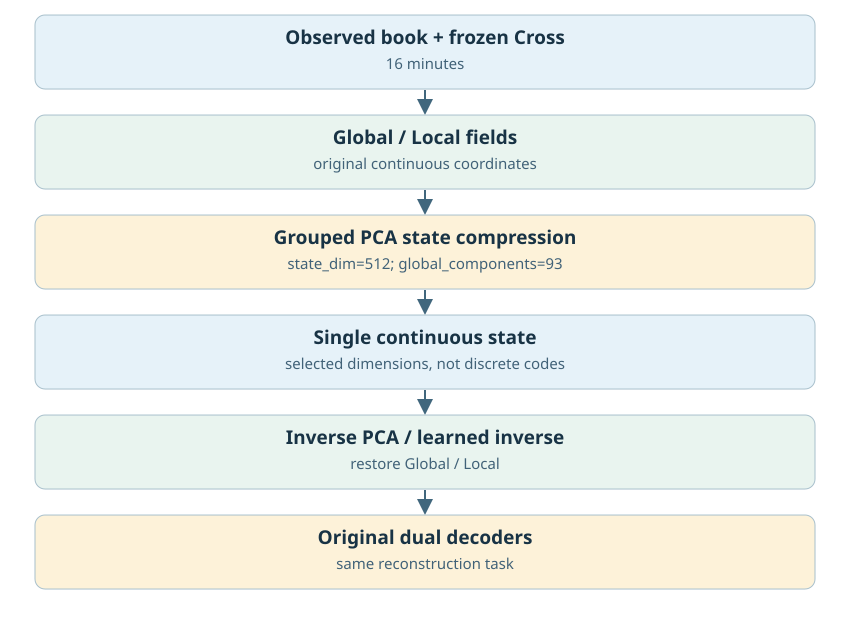
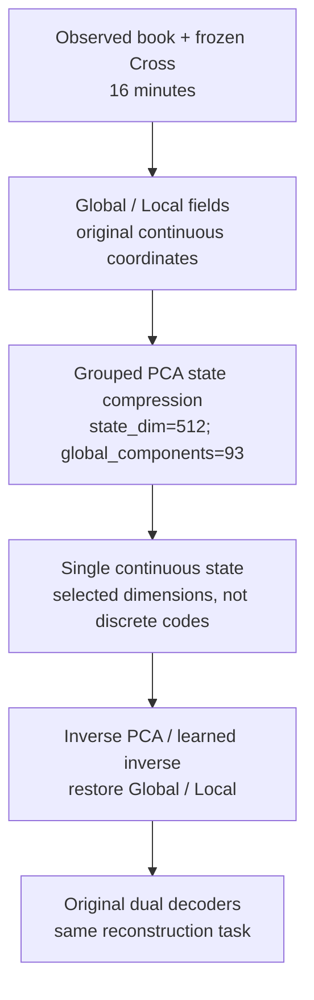
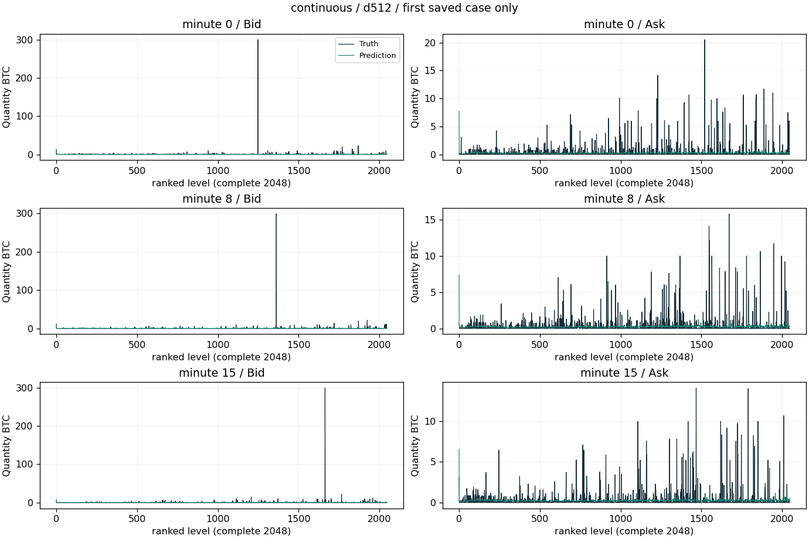
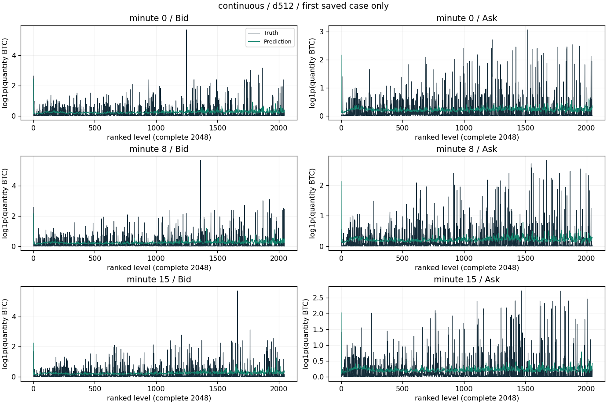
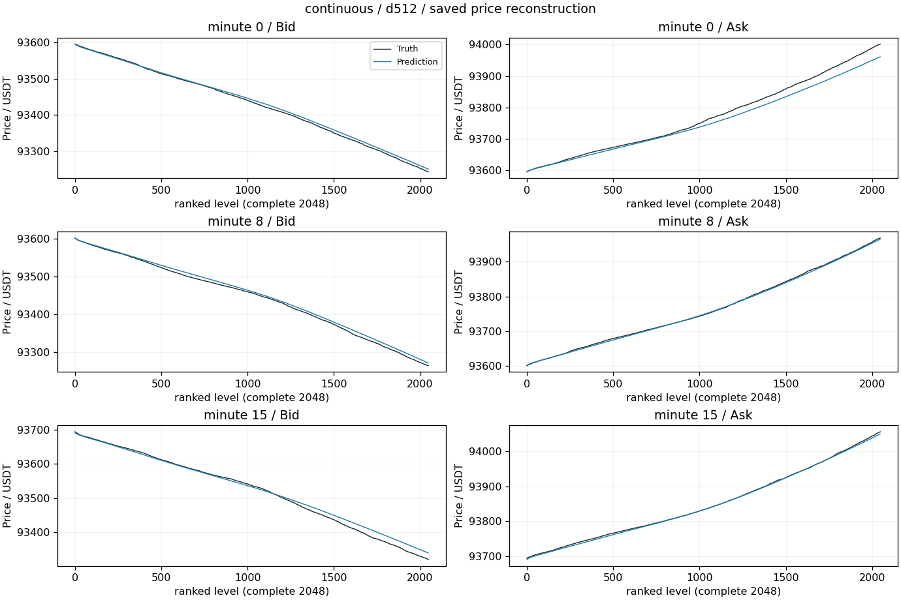
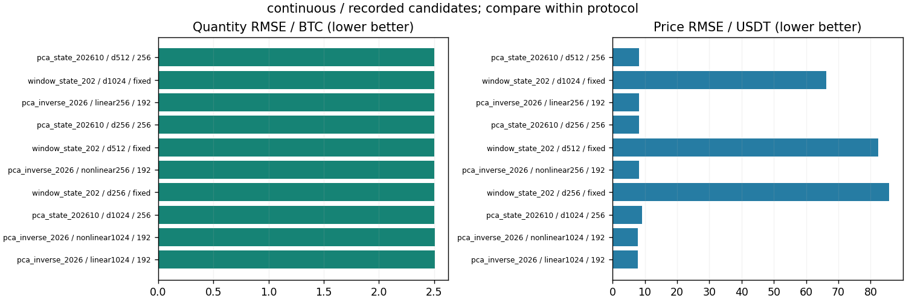

# 连续窗口状态、PCA与学习逆映射

更新：2026-10-29T13:59:27.603099+08:00。输入范围：历史16分钟。

[返回总表](../README.md) · [模型谱系](../../MODEL_LINEAGE.md)

## 模型结构

以下图对应主要展示点的结构；分支其他可选结构见谱系说明，实际开关和精度以检查点配置为准。





- 瓶颈：1024/512/256等候选维数；按具体试验读取。
- 架构变化：WindowState、分组PCA、残差逆映射、学习窗口压缩器。
- 结论边界：PCA训练能量保留率不是重建保真率，也不能证明连续latent的无损下界。
- 原模型代码（相对OBreconstuction）：`model/experimental/window_state.py`, `model/experimental/pca_state.py`, `model/experimental/pca_residual_state.py`, `model/experimental/learned_window_state.py`。

## 各评估口径的最佳已记录检查点

“最佳”定义为本分支、相同窗口长度/测试时段/窗口数/有效计数/目标RMS下所有已保存正步数评估中挂量RMSE最低；这是回顾性选点，包含中间检查点，不冒充独立测试确认；价格、≥100BTC指标和动态相关同时报告，不声称所有指标同时最优。不同口径分别保留最佳点，不做跨口径总冠军。下表第一项只是较大测试样本口径的展示代表。

| 组别 | 步数/epoch | 口径 | 价格RMSE USDT | 挂量RMSE BTC | ≥100召回 | ≥100精确率 | F1 | 动态相关 |
|---|---|---|---:|---:|---:|---:|---:|---:|
| d512 | 256 / None | 16分钟×128窗，['2025-01-01', '2025-04-01'] | 8.17868 | 2.50128 | 0.00% | 未记录 | 0.00% | 0.03980 |

### 最佳点1：d512

- 实验：`checkpoints/pca_state_20261024_222656`。
- 原始指标：`checkpoints/pca_state_20261024_222656/d512/final_evaluation.json`，字段/行：`result`。
- [固定指标证据](best_0_evidence.json) · [权重元数据与哈希](best_0_checkpoint.json) · [原实验计划](best_0_plan.json)。
- 权重：`checkpoints/pca_state_20261024_222656/d512/final.pt`；SHA256 `67cf684ad1b91b402b855cf918aabe2788e95918a0e2e1b030bd0b8710577306`。权重留在原项目，本次不向Git批量上传大检查点。

<details><summary>实际检查点结构配置</summary>

```json
{
  "model_config": {
    "levels": 2048,
    "quantity_scale": 1.0,
    "global_dim": 64,
    "local_dim": 16,
    "causal": false,
    "gap_activation": "softplus",
    "detach_price": false,
    "fix_first_mid": true
  },
  "fusion_variant": "cross",
  "step": 256,
  "pca_state_config": {
    "state_dim": 512,
    "global_components": 93,
    "window_size": 16,
    "pca_seed": 42
  },
  "state_tensor_count": 319,
  "state_scalars": 32594252
}
```

</details>

原始预测：`checkpoints/pca_state_20261024_222656/d512/profiles.npz`，SHA256 `a6f45251060444f8184682136f19dd39ef287fb2d1341ef8c486ea1a85758326`。固定第一个保存案例，分钟[0, 8, 15]，完整2048档。它是案例可视化，不替代全测试统计；没有新增模型推理。







[图中精确数据](best_0_display_points.npz)；未做深度平均、峰值截断或按误差挑样本。

### 若优先大单F1

保留候选中F1最高点：`checkpoints/learned_state_20261025_112037/attention`，step=1024，F1=0.00%，挂量RMSE=2.54386 BTC，价格RMSE=8.4959 USDT。它可能属于不同测试口径，不自动替代上面的最小挂量误差点。完整候选与口径见JSON。

## 所有保留候选与比较边界



图中最多展示10个低挂量误差点，只能在相同口径内比较；所有候选均保留在[candidates.json](candidates.json)。0步初始化不参与已训练分支排名；历史参考/未压缩模型不冒充压缩方案结果；训练拟合、合成移动峰和已见窗口不混入测试排名。历史2025Q1已重复查看，不称独立确认。

<!-- PARETO -->
## 价格与挂量的取舍

最小挂量误差可能以明显价格退化为代价；下面按每个评估口径分别列出价格/挂量二维非支配点（最多10个）。这是多目标取舍，不是因果或显著性结论。完整点仍在候选JSON中。

口径：`[16, ["2025-01-01", "2025-04-01"], 128, 8388608, 2.5344305]`

| 组别 | step / epoch | 价格RMSE | 挂量RMSE |
|---|---|---:|---:|
| d512 | 256 / None | 8.1787 | 2.50128 |
| d256 | 256 / None | 8.1498 | 2.50178 |
| nonlinear1024 | 192 / None | 7.8050 | 2.50419 |
| linear1024 | 192 / None | 7.7965 | 2.50425 |
