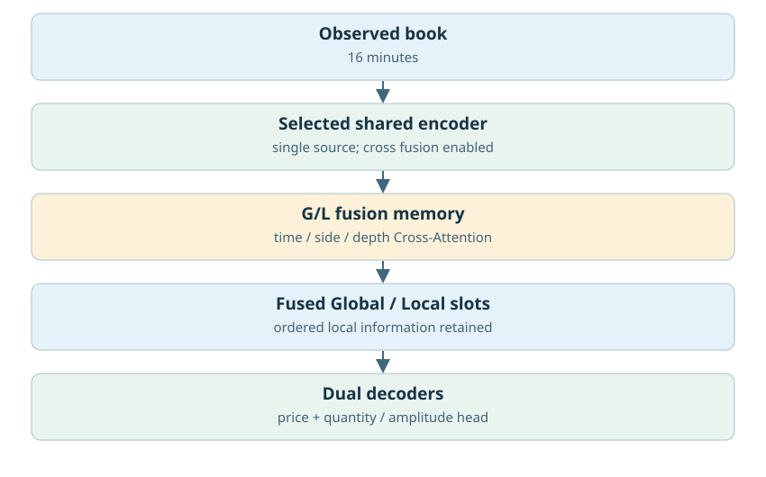
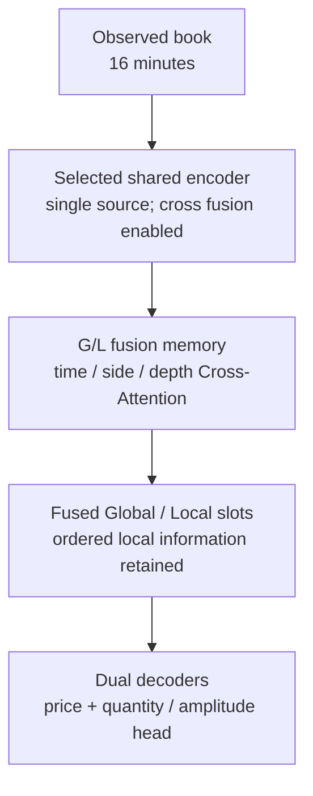
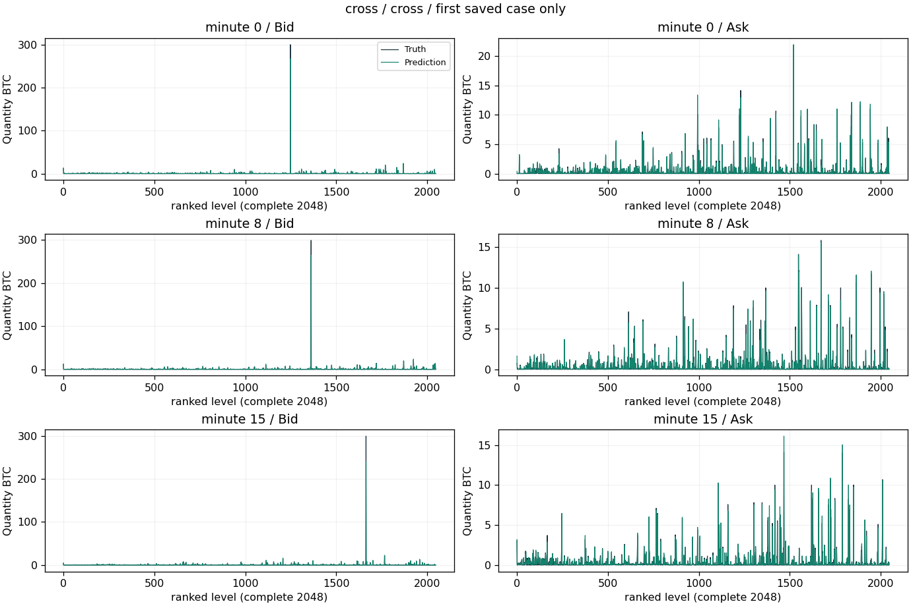
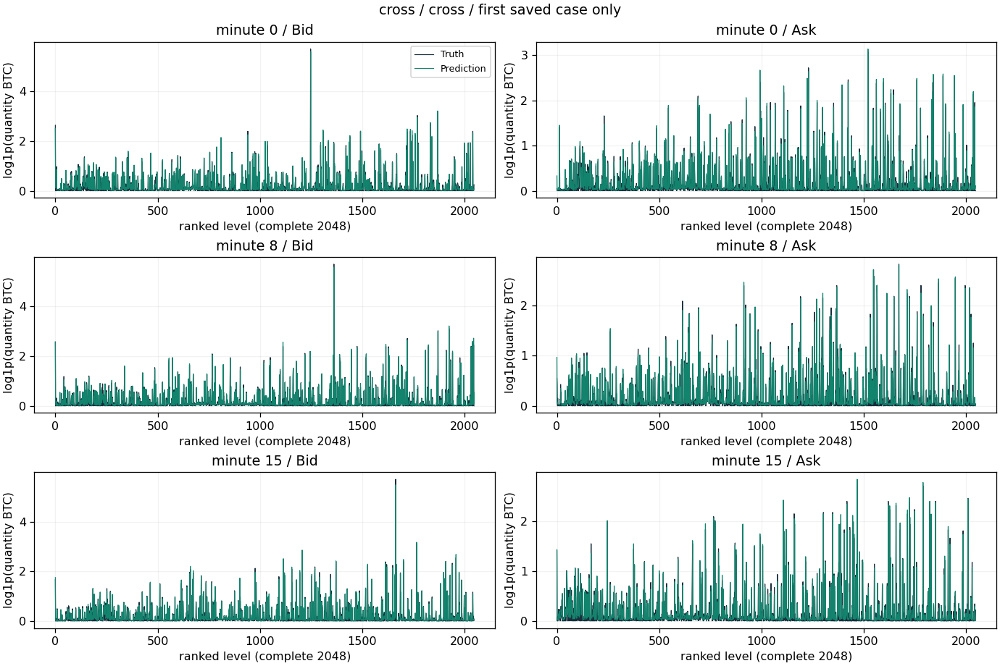
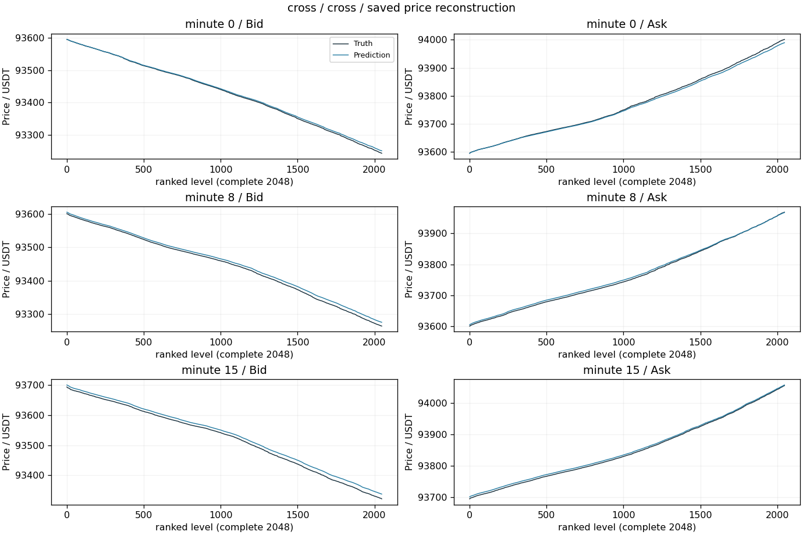
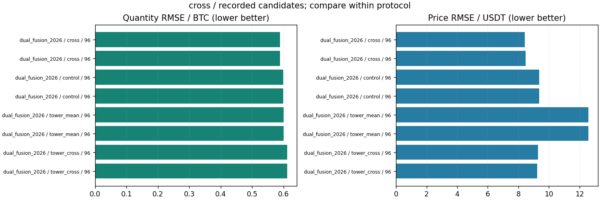

# Cross融合与价量双塔

更新：2026-10-29T13:59:27.603099+08:00。输入范围：历史16分钟。

[返回总表](../README.md) · [模型谱系](../../MODEL_LINEAGE.md)

## 模型结构

以下图对应主要展示点的结构；分支其他可选结构见谱系说明，实际开关和精度以检查点配置为准。





- 瓶颈：融合后的Global/Local有序槽；不自动压缩成单向量。
- 架构变化：control/cross/tower_mean/tower_cross；单Encoder与双塔来源分别比较。
- 结论边界：Cross保留有序局部网格；统一token序列不等于统一低维瓶颈。
- 原模型代码（相对OBreconstuction）：`model/experimental/dual_fusion.py`, `model/encoders/dual_tower.py`, `model/layers/cross_latent.py`。

## 各评估口径的最佳已记录检查点

“最佳”定义为本分支、相同窗口长度/测试时段/窗口数/有效计数/目标RMS下所有已保存正步数评估中挂量RMSE最低；这是回顾性选点，包含中间检查点，不冒充独立测试确认；价格、≥100BTC指标和动态相关同时报告，不声称所有指标同时最优。不同口径分别保留最佳点，不做跨口径总冠军。下表第一项只是较大测试样本口径的展示代表。

| 组别 | 步数/epoch | 口径 | 价格RMSE USDT | 挂量RMSE BTC | ≥100召回 | ≥100精确率 | F1 | 动态相关 |
|---|---|---|---:|---:|---:|---:|---:|---:|
| cross | 96 / None | 16分钟×128窗，['2025-01-01', '2025-04-01'] | 8.40930 | 0.58846 | 97.37% | 93.29% | 95.29% | 0.97871 |

### 最佳点1：cross

- 实验：`checkpoints/dual_fusion_20261024_113046_retry1`。
- 原始指标：`checkpoints/dual_fusion_20261024_113046_retry1/strict_fp32/cross/final_evaluation.json`，字段/行：`result`。
- [固定指标证据](best_0_evidence.json) · [权重元数据与哈希](best_0_checkpoint.json) · [原实验计划](best_0_plan.json)。
- 权重：`checkpoints/dual_fusion_20261024_113046_retry1/cross/final.pt`；SHA256 `3553ad1088a835923ffaa47dbe49f4a08a488437352fbe6a976bab653f410651`。权重留在原项目，本次不向Git批量上传大检查点。

<details><summary>实际检查点结构配置</summary>

```json
{
  "model_config": {
    "levels": 2048,
    "quantity_scale": 1.0,
    "global_dim": 64,
    "local_dim": 16,
    "causal": false,
    "gap_activation": "softplus",
    "detach_price": false,
    "fix_first_mid": true
  },
  "fusion_variant": "cross",
  "step": 96,
  "state_tensor_count": 313,
  "state_scalars": 4906316
}
```

</details>

原始预测：`checkpoints/dual_fusion_20261024_113046_retry1/strict_fp32/cross/profiles.npz`，SHA256 `175d870789e3ea2ab93557b3d9ca2a257e776603ec612f11b3c45015f364b43a`。固定第一个保存案例，分钟[0, 8, 15]，完整2048档。它是案例可视化，不替代全测试统计；没有新增模型推理。







[图中精确数据](best_0_display_points.npz)；未做深度平均、峰值截断或按误差挑样本。

### 若优先大单F1

保留候选中F1最高点：`checkpoints/dual_fusion_20261024_113046_retry1/cross`，step=96，F1=95.38%，挂量RMSE=0.58849 BTC，价格RMSE=8.4651 USDT。它可能属于不同测试口径，不自动替代上面的最小挂量误差点。完整候选与口径见JSON。

## 所有保留候选与比较边界



图中最多展示10个低挂量误差点，只能在相同口径内比较；所有候选均保留在[candidates.json](candidates.json)。0步初始化不参与已训练分支排名；显式稀疏地址诊断单独标明。历史参考/未压缩模型不冒充压缩方案结果；训练拟合、合成移动峰和已见窗口不混入测试排名。历史2025Q1已重复查看，不称独立确认。

<!-- PARETO -->
## 价格与挂量的取舍

最小挂量误差可能以明显价格退化为代价；下面按每个评估口径分别列出价格/挂量二维非支配点（最多10个）。这是多目标取舍，不是因果或显著性结论。完整点仍在候选JSON中。

口径：`[16, ["2025-01-01", "2025-04-01"], 128, 8388608, 2.5344305]`

| 组别 | step / epoch | 价格RMSE | 挂量RMSE |
|---|---|---:|---:|
| cross | 96 / None | 8.4093 | 0.58846 |
