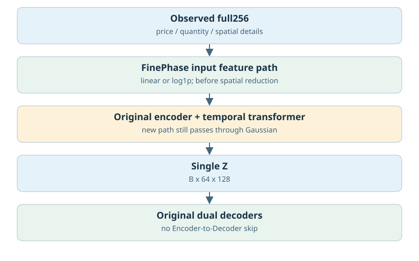
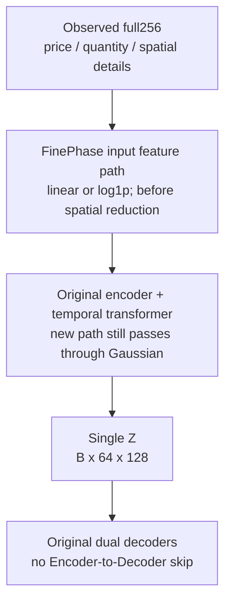
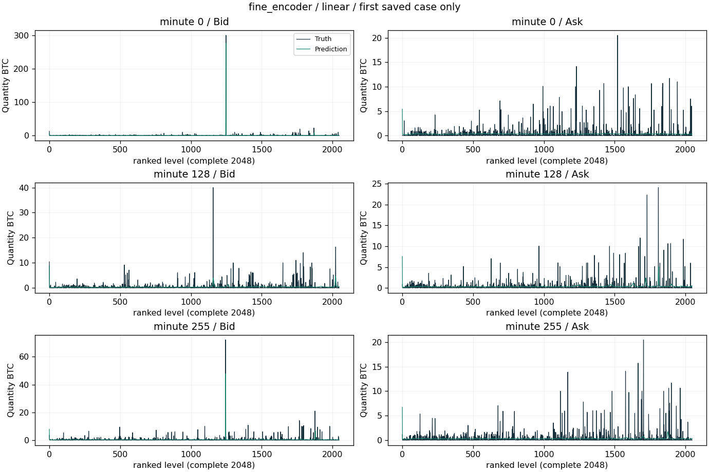
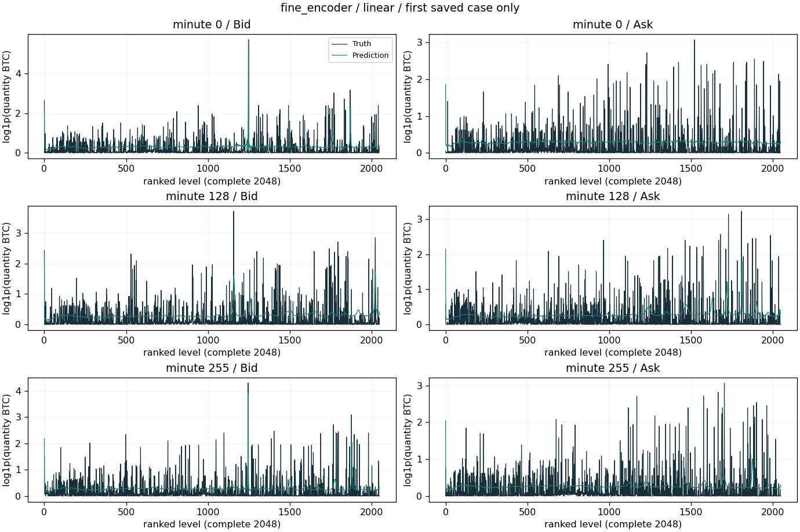
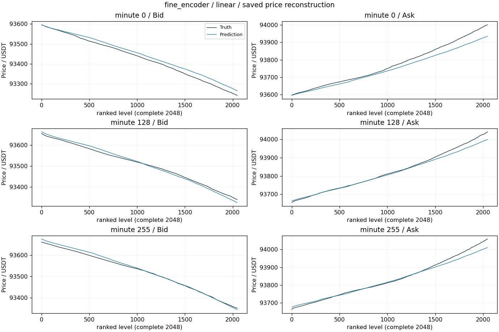
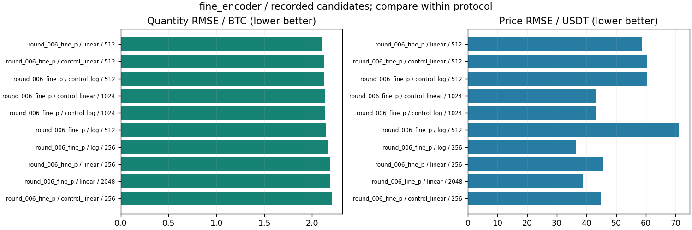

# 细粒度Encoder旁路特征适配

更新：2026-10-29T13:59:27.603099+08:00。输入范围：完整256分钟。

[返回总表](../README.md) · [模型谱系](../../MODEL_LINEAGE.md)

## 模型结构

以下图对应主要展示点的结构；分支其他可选结构见谱系说明，实际开关和精度以检查点配置为准。





- 瓶颈：唯一[B,64,128]不变。
- 架构变化：在空间下采样前补充数量细节特征；linear/log1p开关与关闭路径控制。
- 结论边界：这里的特征旁路仍位于Encoder内部并通过唯一Z；不是Encoder到Decoder的越过瓶颈旁路。
- 原模型代码（相对OBreconstuction）：`model/autoencoder/fine_phase_vae.py`。

## 各评估口径的最佳已记录检查点

“最佳”定义为本分支、相同窗口长度/测试时段/窗口数/有效计数/目标RMS下所有已保存正步数评估中挂量RMSE最低；这是回顾性选点，包含中间检查点，不冒充独立测试确认；价格、≥100BTC指标和动态相关同时报告，不声称所有指标同时最优。不同口径分别保留最佳点，不做跨口径总冠军。下表第一项只是较大测试样本口径的展示代表。

| 组别 | 步数/epoch | 口径 | 价格RMSE USDT | 挂量RMSE BTC | ≥100召回 | ≥100精确率 | F1 | 动态相关 |
|---|---|---|---:|---:|---:|---:|---:|---:|
| linear | 512 / None | 256分钟×16窗，['2025-01-01', '2025-04-01'] | 58.64514 | 2.10353 | 69.91% | 44.47% | 54.36% | 0.12842 |

### 最佳点1：linear

- 实验：`recons/recall80_goal_20261027_235344/round_006_fine_phase`。
- 原始指标：`recons/recall80_goal_20261027_235344/round_006_fine_phase/linear/step512_development.json`，字段/行：`result`。
- [固定指标证据](best_0_evidence.json) · [权重元数据与哈希](best_0_checkpoint.json) · [原实验计划](best_0_plan.json)。
- 权重：`recons/recall80_goal_20261027_235344/round_006_fine_phase/linear/step512.pt`；SHA256 `357faea89efd69dbc7f4282b18dc064549baa578d7b51df1d6d79d7e032c258c`。权重留在原项目，本次不向Git批量上传大检查点。

<details><summary>实际检查点结构配置</summary>

```json
{
  "unified_vae_config": {
    "levels": 2048,
    "quantity_scale": 7.517722085208762,
    "activation_checkpointing": true
  },
  "local_hint_config": {
    "layout": "frame1",
    "frame_ffn": 1536
  },
  "step": 512,
  "lane": "linear",
  "hint_loss_config": {
    "state": "complete",
    "channel_mean": [
      0.9250172972679138,
      1.8531343936920166,
      1.5194728374481201,
      1.7943356037139893,
      -1.4503252506256104,
      2.4705286026000977,
      0.3860763907432556,
      1.8132270574569702,
      -0.06249728426337242,
      -0.31646180152893066,
      -0.07554971426725388,
      -0.5030801892280579,
      -0.9876208305358887,
      0.712155818939209,
      -0.4036191403865814,
      0.38522931933403015
    ],
    "channel_scale": [
      0.9728396534919739,
      1.4675811529159546,
      1.2437142133712769,
      2.314589500427246,
      1.4124771356582642,
      7.2413859367370605,
      1.2508740425109863,
      3.029496192932129,
      1.713751196861267,
      3.252234697341919,
      1.3342822790145874,
      1.5868194103240967,
      1.2489420175552368,
      2.3378970623016357,
      1.362396240234375,
      1.2974568605422974
    ],
    "amplitude_bounds": [
      106.1989974975586,
      492.50299072265625
    ],
    "hint_weight": 0.00014210892251719886,
    "teacher_sha256": "542758346c8ed763dc4c04738eb7e9a0080c5959a164acefd4e7dff981dd19c6",
    "training_indices": [
      0,
      872,
      1755,
      2639,
      3515,
      4394,
      5266,
      6152
    ],
    "base_mu_gradient_rms": 0.7122394079445133,
    "raw_hint_mu_gradient_rms": 1252.9815076500806,
    "ratio": 0.25,
    "teacher_hash_unchanged": true,
    "scope": "8 preselected trainingwindows only, nooptimizerupdates/nodevelopmentcalibration; teacherownnormalizer, FP32teacher/BF16student.",
    "tail_weight": 0.04034386474777693,
    "mid_weight": 0.8240454165997028,
    "new_weights_state": "locked",
    "new_gradient_rms": {
      "pre_guard_loss": 3.519685725838934,
      "tail_positive_huber": 87.2421556001989,
      "tail_false_positive_huber": 110.53622288473561,
      "tail_balanced": 152.3454995859868,
      "mid_protection": 4.271227841254646
    },
    "new_weight_scope": "8preselectedtrainwindows only; nooptimizerupdate; equalinitialmuheadgradientRMS1.0; notdevelopment-selected.",
    "positive_fp_gradient_cosine": 0.17617753477665446,
    "scope_new_weights": "8fixedtrainingwindows,positive-onlymu-gradientRMS1xbaseandmidRMS1xbase;commonall4,nooptimizerupdate/noQ2."
  },
  "fine_phase_config": {
    "layout": "frame1",
    "frame_ffn": 1536,
    "fine_enabled": true,
    "fine_transform": "linear",
    "fine_hidden": 256
  },
  "state_tensor_count": 248,
  "state_scalars": 12801350
}
```

</details>

原始预测：`recons/recall80_goal_20261027_235344/round_006_fine_phase/linear/step512_profiles.npz`，SHA256 `5ff5f359f408c8dd5fd9922c8a3bede3ff272da73d081efba6447766d96d5916`。固定第一个保存案例，分钟[0, 128, 255]，完整2048档。它是案例可视化，不替代全测试统计；没有新增模型推理。







[图中精确数据](best_0_display_points.npz)；未做深度平均、峰值截断或按误差挑样本。

### 若优先大单F1

保留候选中F1最高点：`recons/recall80_goal_20261027_235344/round_006_fine_phase/control_linear`，step=2048，F1=56.04%，挂量RMSE=2.21794 BTC，价格RMSE=35.6337 USDT。它可能属于不同测试口径，不自动替代上面的最小挂量误差点。完整候选与口径见JSON。

## 同预算共同终点参考

该分支保留的共同终点评估中，最低挂量误差点为`recons/recall80_goal_20261027_235344/round_006_fine_phase/linear`，step=2048，挂量RMSE=2.19371 BTC、价格RMSE=38.8828 USDT。它与回顾性最低误差检查点是两个选型口径；不同来源或测试协议不能据此直接作因果比较。

## 所有保留候选与比较边界



图中最多展示10个低挂量误差点，只能在相同口径内比较；所有候选均保留在[candidates.json](candidates.json)。0步初始化不参与已训练分支排名；历史参考/未压缩模型不冒充压缩方案结果；训练拟合、合成移动峰和已见窗口不混入测试排名。历史2025Q1已重复查看，不称独立确认。

<!-- PARETO -->
## 价格与挂量的取舍

最小挂量误差可能以明显价格退化为代价；下面按每个评估口径分别列出价格/挂量二维非支配点（最多10个）。这是多目标取舍，不是因果或显著性结论。完整点仍在候选JSON中。

口径：`[256, ["2025-01-01", "2025-04-01"], 16, 16777216, 2.2170201]`

| 组别 | step / epoch | 价格RMSE | 挂量RMSE |
|---|---|---:|---:|
| linear | 512 / None | 58.6451 | 2.10353 |
| control_linear | 1024 / None | 42.9672 | 2.13709 |
| log | 256 / None | 36.4962 | 2.17429 |
| control_linear | 2048 / None | 35.6337 | 2.21794 |
