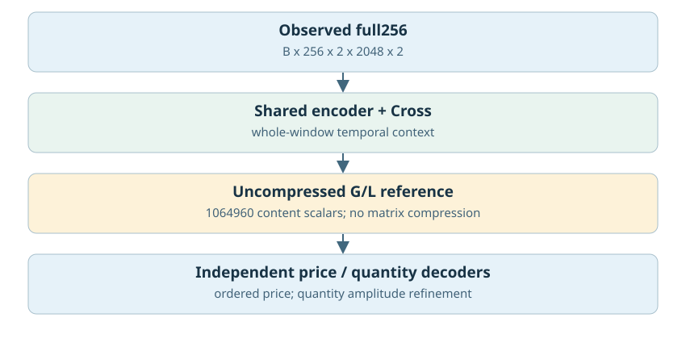
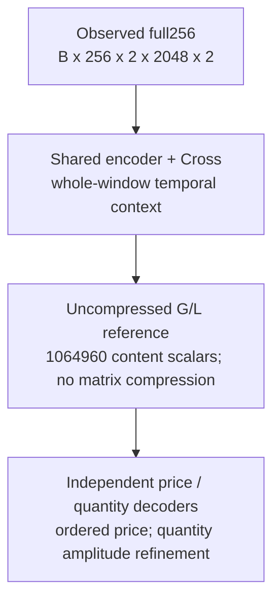
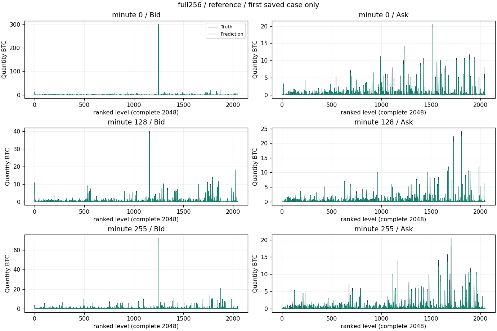
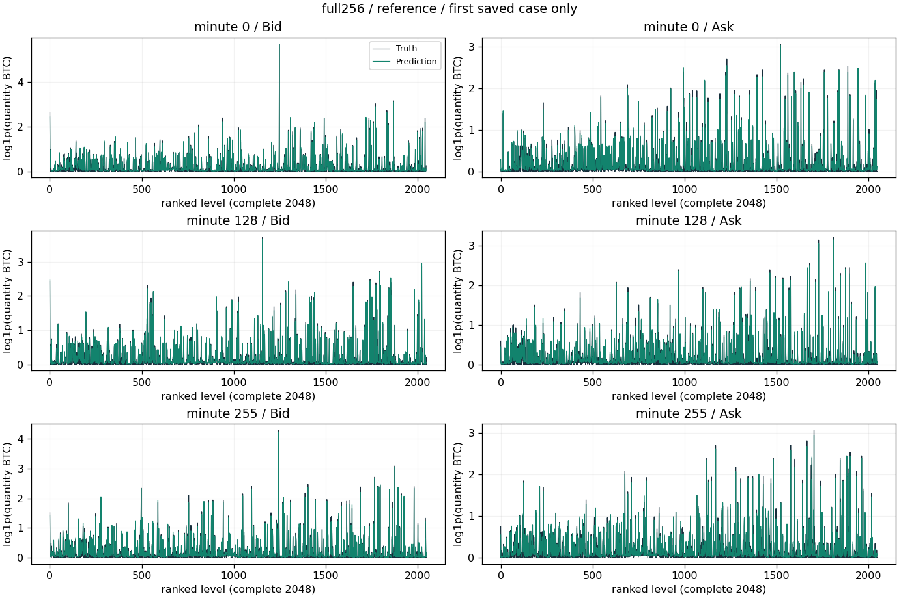
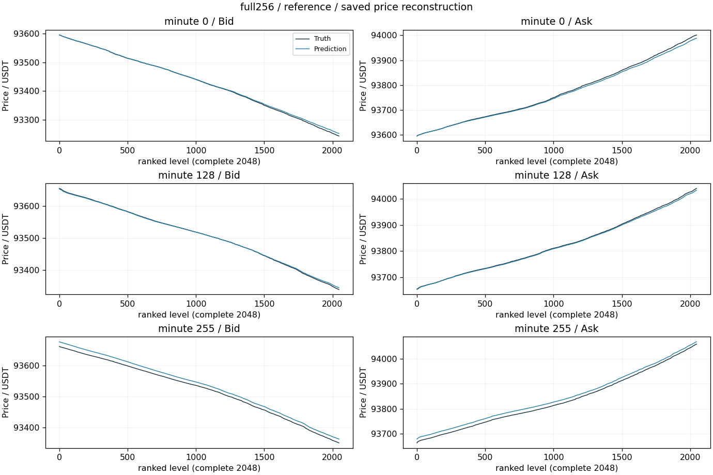
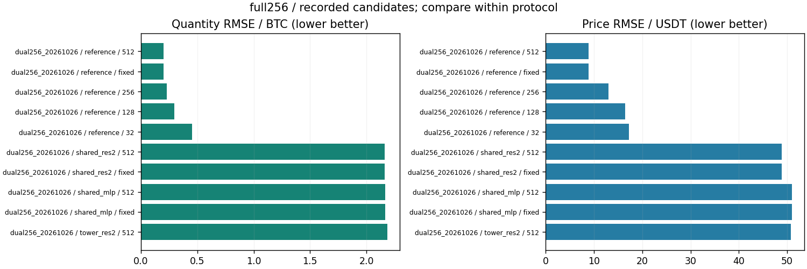

# 恢复完整256分钟：Cross参考/矩阵压缩

更新：2026-10-29T13:59:27.603099+08:00。输入范围：实测完整256分钟。

[返回总表](../README.md) · [模型谱系](../../MODEL_LINEAGE.md)

## 模型结构

以下图对应主要展示点的结构；分支其他可选结构见谱系说明，实际开关和精度以检查点配置为准。





- 瓶颈：未压缩G/L合计1064960标量；压缩组[B,16,1024]。
- 架构变化：共享/双塔完整窗编码；通道压缩＋时间压缩；浅层/残差MLP。
- 结论边界：未压缩参考重建质量强，但容量远大于8192；旧16分钟权重仅初始化，实际完整窗训练单独进行。
- 原模型代码（相对OBreconstuction）：`model/experimental/full_window_matrix.py`, `model/autoencoder/window_matrix_codec.py`。

## 各评估口径的最佳已记录检查点

“最佳”定义为本分支、相同窗口长度/测试时段/窗口数/有效计数/目标RMS下所有已保存正步数评估中挂量RMSE最低；这是回顾性选点，包含中间检查点，不冒充独立测试确认；价格、≥100BTC指标和动态相关同时报告，不声称所有指标同时最优。不同口径分别保留最佳点，不做跨口径总冠军。下表第一项只是较大测试样本口径的展示代表。

| 组别 | 步数/epoch | 口径 | 价格RMSE USDT | 挂量RMSE BTC | ≥100召回 | ≥100精确率 | F1 | 动态相关 |
|---|---|---|---:|---:|---:|---:|---:|---:|
| reference | 512 / None | 256分钟×16窗，['2025-01-01', '2025-04-01'] | 8.87358 | 0.19861 | 93.83% | 97.86% | 95.80% | 0.97814 |

### 最佳点1：reference

- 实验：`checkpoints/dual256_20261026_090533`。
- 原始指标：`checkpoints/dual256_20261026_090533/reference/step512_evaluation.json`，字段/行：`result`。
- [固定指标证据](best_0_evidence.json) · [权重元数据与哈希](best_0_checkpoint.json) · [原实验计划](best_0_plan.json)。
- **该点是控制/参考路径，不代表新增模块改善。**
- 权重：`checkpoints/dual256_20261026_090533/reference/step512.pt`；SHA256 `ba310dfc02262f3b1ce528e69e44ae5d48530ded1bf3ac5006a44902b61f1927`。权重留在原项目，本次不向Git批量上传大检查点。

<details><summary>实际检查点结构配置</summary>

```json
{
  "model_config": {
    "levels": 2048,
    "quantity_scale": 1.0,
    "global_dim": 64,
    "local_dim": 16,
    "causal": false,
    "gap_activation": "softplus",
    "detach_price": false,
    "fix_first_mid": true
  },
  "window_matrix_config": {
    "window_size": 256,
    "matrix_rows": 16,
    "matrix_dim": 1024,
    "frame_dim": 256,
    "codec_kind": "nonlinear",
    "codec_depth": 0,
    "codec_hidden": 512,
    "branch_mode": "shared",
    "compress": false,
    "activation_checkpoint": true
  },
  "step": 512,
  "state_tensor_count": 313,
  "state_scalars": 4906316
}
```

</details>

原始预测：`checkpoints/dual256_20261026_090533/reference/step512_profiles.npz`，SHA256 `68c7a6125d9d18e63247cd6a121e78c721dfdced859bc3692bf7415c777dfd2e`。固定第一个保存案例，分钟[0, 128, 255]，完整2048档。它是案例可视化，不替代全测试统计；没有新增模型推理。







[图中精确数据](best_0_display_points.npz)；未做深度平均、峰值截断或按误差挑样本。

### 若优先大单F1

保留候选中F1最高点：`checkpoints/dual256_20261026_090533/reference`，step=256，F1=96.16%，挂量RMSE=0.22853 BTC，价格RMSE=13.0053 USDT。它可能属于不同测试口径，不自动替代上面的最小挂量误差点。完整候选与口径见JSON。

## 同预算共同终点参考

该分支保留的共同终点评估中，最低挂量误差点为`checkpoints/dual256_20261026_090533/reference`，step=512，挂量RMSE=0.19861 BTC、价格RMSE=8.8736 USDT。它与回顾性最低误差检查点是两个选型口径；不同来源或测试协议不能据此直接作因果比较。

## 所有保留候选与比较边界



图中最多展示10个低挂量误差点，只能在相同口径内比较；所有候选均保留在[candidates.json](candidates.json)。0步初始化不参与已训练分支排名；显式稀疏地址诊断单独标明。历史参考/未压缩模型不冒充压缩方案结果；训练拟合、合成移动峰和已见窗口不混入测试排名。历史2025Q1已重复查看，不称独立确认。

<!-- PARETO -->
## 价格与挂量的取舍

最小挂量误差可能以明显价格退化为代价；下面按每个评估口径分别列出价格/挂量二维非支配点（最多10个）。这是多目标取舍，不是因果或显著性结论。完整点仍在候选JSON中。

口径：`[256, ["2025-01-01", "2025-04-01"], 16, 16777216, 2.2170201]`

| 组别 | step / epoch | 价格RMSE | 挂量RMSE |
|---|---|---:|---:|
| reference | 512 / None | 8.8736 | 0.19861 |
