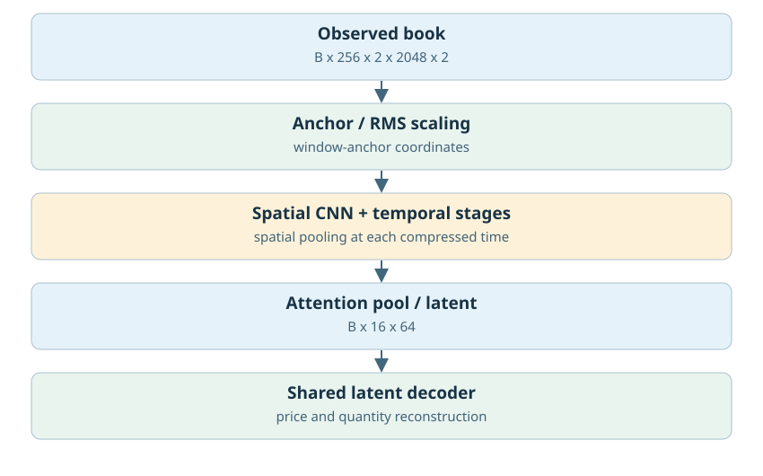
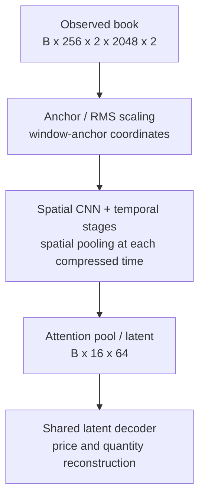
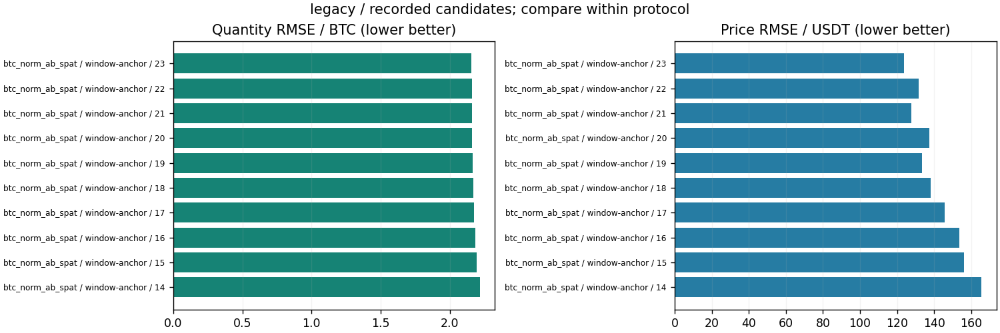

# 早期MLP/卷积AE与1024瓶颈

更新：2026-10-29T13:59:27.603099+08:00。输入范围：早期计划为256分钟；各次实际形状需单独核对。

[返回总表](../README.md) · [模型谱系](../../MODEL_LINEAGE.md)

## 模型结构

以下图对应主要展示点的结构；分支其他可选结构见谱系说明，实际开关和精度以检查点配置为准。





- 瓶颈：典型[B,16,64]，1024标量；非当前8192配置。
- 架构变化：线性RMS/首帧mid归一化；MLP/卷积重建；后续引出局部查询。
- 结论边界：不能用这些旧模型的latent默认值覆盖当前主线。
- 原模型代码（相对OBreconstuction）：`model/factory.py`, `model/autoencoder/encoder.py`, `model/autoencoder/decoder.py`。

## 各评估口径的最佳已记录检查点

“最佳”定义为本分支、相同窗口长度/测试时段/窗口数/有效计数/目标RMS下所有已保存正步数评估中挂量RMSE最低；这是回顾性选点，包含中间检查点，不冒充独立测试确认；价格、≥100BTC指标和动态相关同时报告，不声称所有指标同时最优。不同口径分别保留最佳点，不做跨口径总冠军。下表第一项只是较大测试样本口径的展示代表。

| 组别 | 步数/epoch | 口径 | 价格RMSE USDT | 挂量RMSE BTC | ≥100召回 | ≥100精确率 | F1 | 动态相关 |
|---|---|---|---:|---:|---:|---:|---:|---:|
| window-anchor | 1472 / 23 | 256分钟×694窗，['2025-01-01', '2025-02-01'] | 123.87980 | 2.15616 | 未记录 | 未记录 | 未记录 | 未记录 |

### 最佳点1：window-anchor

- 实验：`checkpoints/btc_norm_ab_spatial16x64_20261018_173307`。
- 原始指标：`checkpoints/btc_norm_ab_spatial16x64_20261018_173307/window-anchor/metrics.jsonl`，字段/行：`line:23:validation`。
- [固定指标证据](best_0_evidence.json) · [权重元数据与哈希](best_0_checkpoint.json) · [原实验计划](best_0_plan.json)。
- 权重：`checkpoints/btc_norm_ab_spatial16x64_20261018_173307/window-anchor/best_val.pt`；SHA256 `399af87db3b701a25b7129717e5f9467efaa79610716bc416be60e5727911047`。权重留在原项目，本次不向Git批量上传大检查点。

<details><summary>实际检查点结构配置</summary>

```json
{
  "epoch": 23,
  "model_config": {
    "architecture": "ae_spatial_pool_v3",
    "latent_dim": 64,
    "bottleneck": "per-time spatial attention pooling; no temporal mixing or token-channel flattening",
    "latent_shape_per_sample": [
      16,
      64
    ]
  },
  "state_tensor_count": 106,
  "state_scalars": 1318658
}
```

</details>

未找到与这个最佳点明确匹配的保存订单簿预测。本页展示真实指标/训练历史图，不借用其他检查点的曲线，不伪造订单簿预览。

## 所有保留候选与比较边界



图中最多展示10个低挂量误差点，只能在相同口径内比较；所有候选均保留在[candidates.json](candidates.json)。0步初始化不参与已训练分支排名；显式稀疏地址诊断单独标明。历史参考/未压缩模型不冒充压缩方案结果；训练拟合、合成移动峰和已见窗口不混入测试排名。历史2025Q1已重复查看，不称独立确认。

<!-- PARETO -->
## 价格与挂量的取舍

最小挂量误差可能以明显价格退化为代价；下面按每个评估口径分别列出价格/挂量二维非支配点（最多10个）。这是多目标取舍，不是因果或显著性结论。完整点仍在候选JSON中。

口径：`[256, ["2025-01-01", "2025-02-01"], 694, 727684864, null]`

| 组别 | step / epoch | 价格RMSE | 挂量RMSE |
|---|---|---:|---:|
| window-anchor | 1472 / 23 | 123.8798 | 2.15616 |
