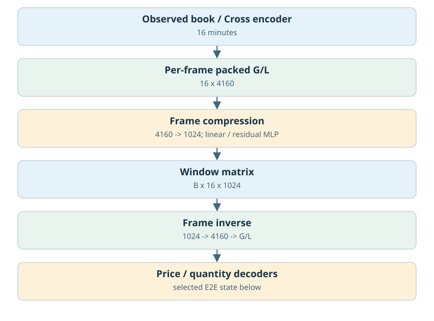
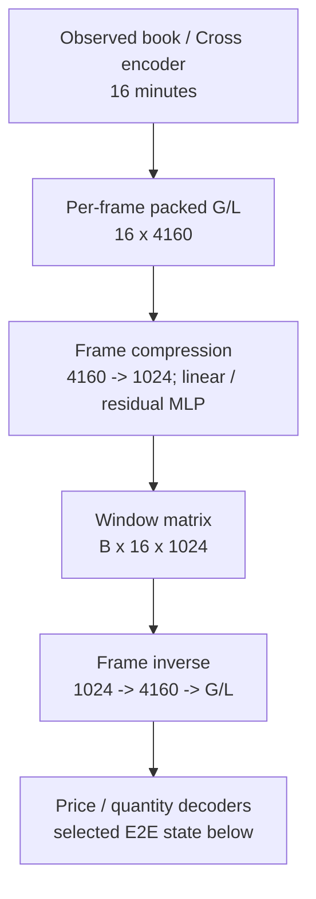
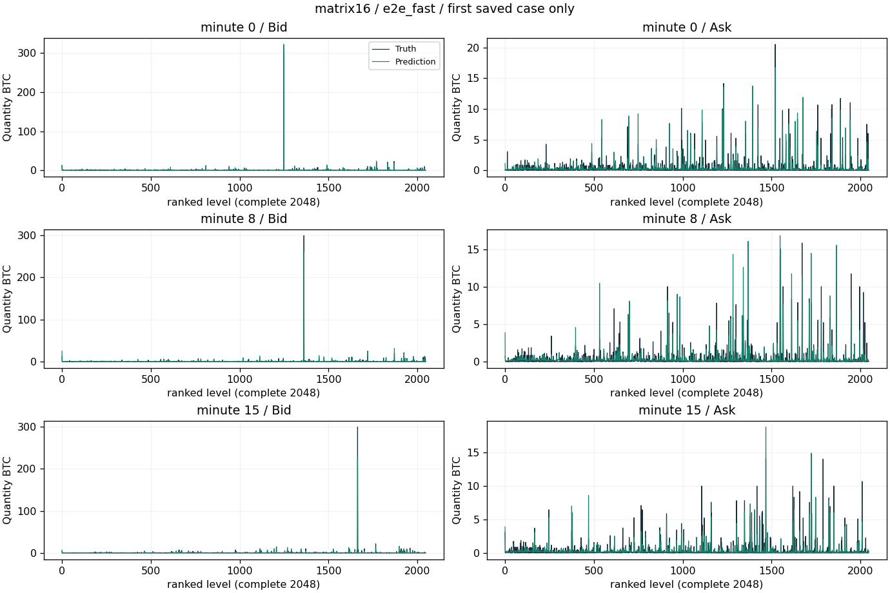
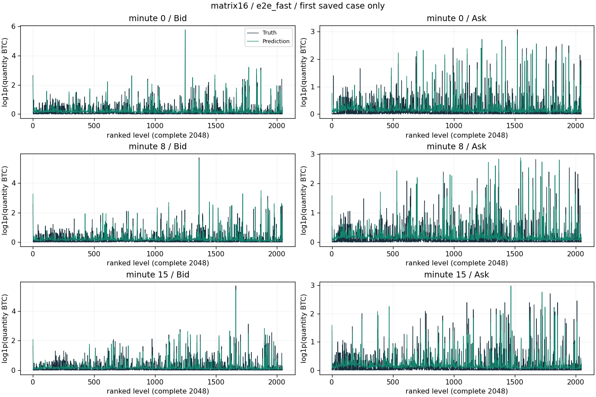
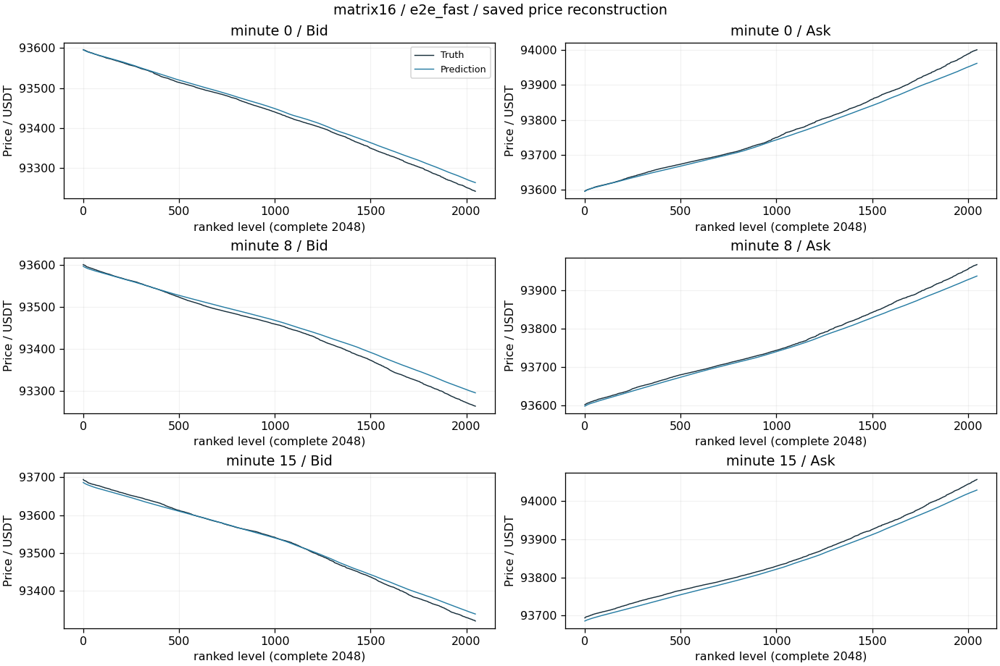
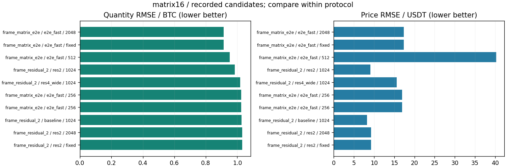

# 每帧矩阵压缩与端到端残差深度

更新：2026-10-29T13:59:27.603099+08:00。输入范围：历史16分钟。

[返回总表](../README.md) · [模型谱系](../../MODEL_LINEAGE.md)

## 模型结构

以下图对应主要展示点的结构；分支其他可选结构见谱系说明，实际开关和精度以检查点配置为准。





- 瓶颈：[B,16,1024]，16384标量。
- 架构变化：Global/Local每帧4160→1024；线性/非线性；Decoder适配与端到端；残差深度。
- 结论边界：该16×1024是每帧压缩后的历史16分钟结果，不能与后续整窗256分钟的同形状状态混淆。
- 原模型代码（相对OBreconstuction）：`model/experimental/frame_matrix_state.py`, `model/autoencoder/frame_matrix_codec.py`。

## 各评估口径的最佳已记录检查点

“最佳”定义为本分支、相同窗口长度/测试时段/窗口数/有效计数/目标RMS下所有已保存正步数评估中挂量RMSE最低；这是回顾性选点，包含中间检查点，不冒充独立测试确认；价格、≥100BTC指标和动态相关同时报告，不声称所有指标同时最优。不同口径分别保留最佳点，不做跨口径总冠军。下表第一项只是较大测试样本口径的展示代表。

| 组别 | 步数/epoch | 口径 | 价格RMSE USDT | 挂量RMSE BTC | ≥100召回 | ≥100精确率 | F1 | 动态相关 |
|---|---|---|---:|---:|---:|---:|---:|---:|
| e2e_fast | 2048 / None | 16分钟×64窗，['2025-01-01', '2025-04-01'] | 17.35740 | 0.91262 | 80.24% | 97.15% | 87.89% | 0.72774 |

### 最佳点1：e2e_fast

- 实验：`checkpoints/frame_matrix_e2e_resume_20261025_234027`。
- 原始指标：`checkpoints/frame_matrix_e2e_resume_20261025_234027/e2e_fast/step2048_evaluation.json`，字段/行：`result`。
- [固定指标证据](best_0_evidence.json) · [权重元数据与哈希](best_0_checkpoint.json) · [原实验计划](best_0_plan.json)。
- 权重：`checkpoints/frame_matrix_e2e_resume_20261025_234027/e2e_fast/step2048.pt`；SHA256 `c537e3adce11c6f8df0524543aa74ba6861d7fc9f301c1ed78e04c8cd5a4ad25`。权重留在原项目，本次不向Git批量上传大检查点。

<details><summary>实际检查点结构配置</summary>

```json
{
  "model_config": {
    "levels": 2048,
    "quantity_scale": 1.0,
    "global_dim": 64,
    "local_dim": 16,
    "causal": false,
    "gap_activation": "softplus",
    "detach_price": false,
    "fix_first_mid": true
  },
  "frame_matrix_config": {
    "matrix_dim": 1024,
    "codec_kind": "nonlinear",
    "codec_hidden": 512,
    "codec_seed": 42
  },
  "step": 2048,
  "state_tensor_count": 324,
  "state_scalars": 18744780
}
```

</details>

原始预测：`checkpoints/frame_matrix_e2e_resume_20261025_234027/e2e_fast/profiles.npz`，SHA256 `a0778896b4daa94e1a6e22d3ed4a54a3a9fd4198ad43f556c12e2e1c5f53c22a`。固定第一个保存案例，分钟[0, 8, 15]，完整2048档。它是案例可视化，不替代全测试统计；没有新增模型推理。







[图中精确数据](best_0_display_points.npz)；未做深度平均、峰值截断或按误差挑样本。

### 若优先大单F1

保留候选中F1最高点：`checkpoints/frame_matrix_e2e_resume_20261025_234027/e2e_fast`，step=2048，F1=87.89%，挂量RMSE=0.91262 BTC，价格RMSE=17.3574 USDT。它可能属于不同测试口径，不自动替代上面的最小挂量误差点。完整候选与口径见JSON。

## 同预算共同终点参考

该分支保留的共同终点评估中，最低挂量误差点为`checkpoints/frame_matrix_e2e_resume_20261025_234027/e2e_fast`，step=2048，挂量RMSE=0.91262 BTC、价格RMSE=17.3574 USDT。它与回顾性最低误差检查点是两个选型口径；不同来源或测试协议不能据此直接作因果比较。

## 所有保留候选与比较边界



图中最多展示10个低挂量误差点，只能在相同口径内比较；所有候选均保留在[candidates.json](candidates.json)。0步初始化不参与已训练分支排名；历史参考/未压缩模型不冒充压缩方案结果；训练拟合、合成移动峰和已见窗口不混入测试排名。历史2025Q1已重复查看，不称独立确认。

<!-- PARETO -->
## 价格与挂量的取舍

最小挂量误差可能以明显价格退化为代价；下面按每个评估口径分别列出价格/挂量二维非支配点（最多10个）。这是多目标取舍，不是因果或显著性结论。完整点仍在候选JSON中。

口径：`[16, ["2025-01-01", "2025-04-01"], 64, 4194304, 2.6643464]`

| 组别 | step / epoch | 价格RMSE | 挂量RMSE |
|---|---|---:|---:|
| e2e_fast | 2048 / None | 17.3574 | 0.91262 |
| res2 | 1024 / None | 9.1172 | 0.98435 |
| baseline | 1024 / None | 8.2346 | 1.02757 |
| e2e | 1024 / None | 7.6638 | 1.04323 |
| e2e | 256 / None | 7.6478 | 1.08664 |
| baseline | 256 / None | 7.6477 | 1.08664 |
| frozen_long | 2048 / None | 7.4310 | 2.05674 |
| frozen_long | 1024 / None | 7.1766 | 2.07875 |
| fixed_pca | None / None | 7.0153 | 2.39915 |
