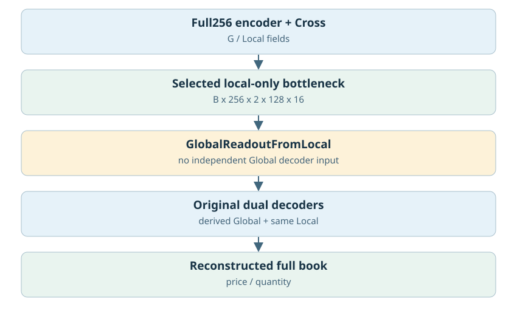
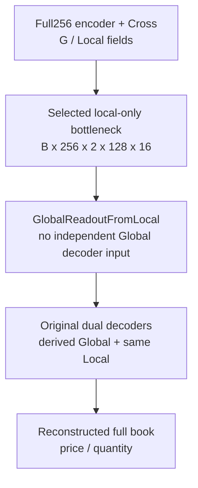
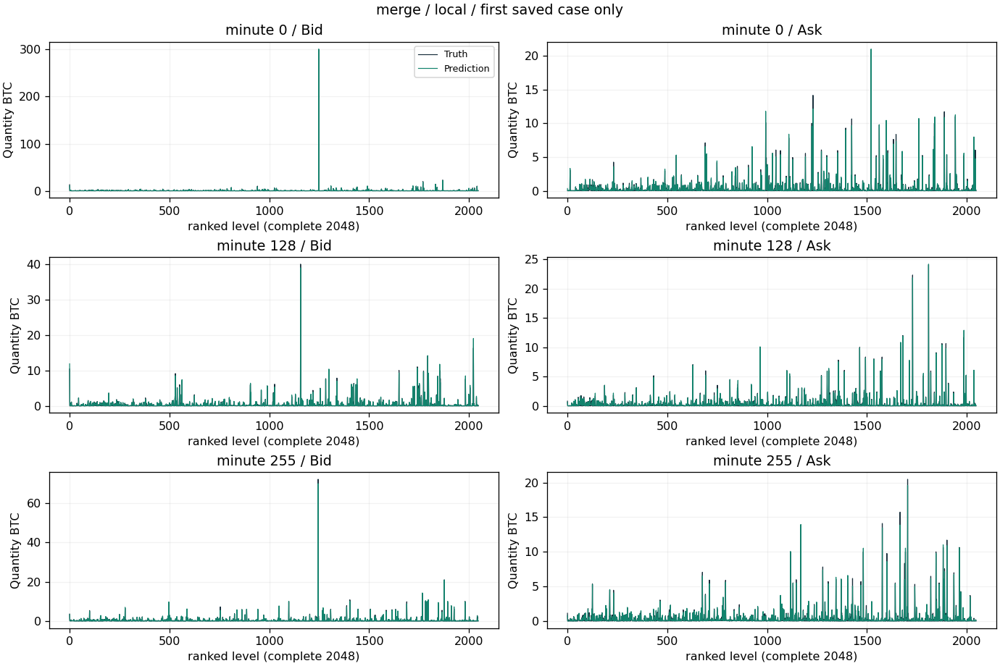
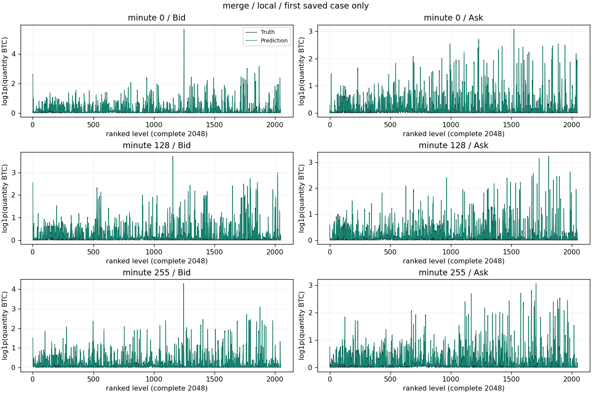
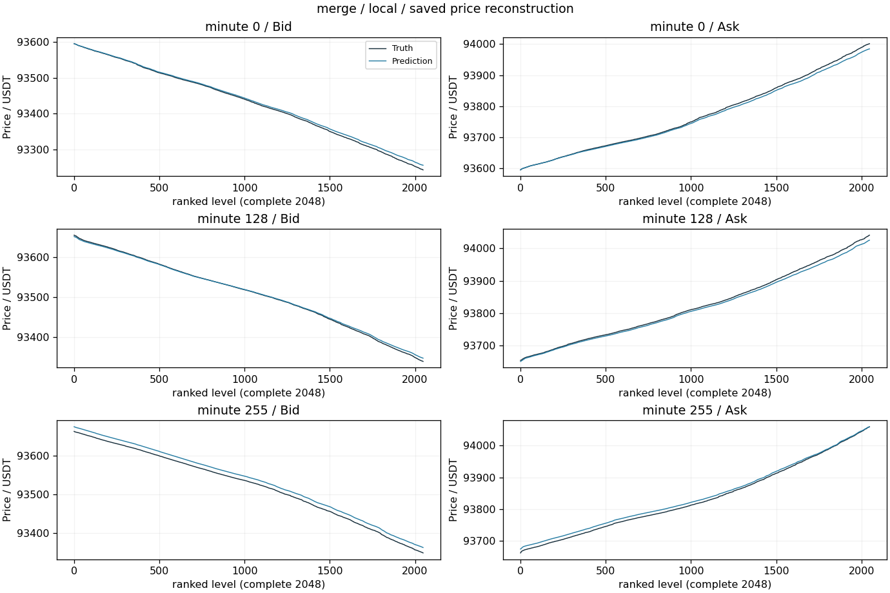
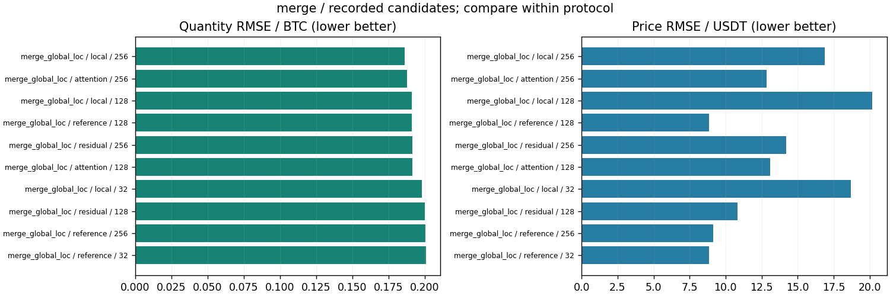

# Global并入Local的敏感性/融合

更新：2026-10-29T13:59:27.603099+08:00。输入范围：完整256分钟。

[返回总表](../README.md) · [模型谱系](../../MODEL_LINEAGE.md)

## 模型结构

以下图对应主要展示点的结构；分支其他可选结构见谱系说明，实际开关和精度以检查点配置为准。





- 瓶颈：沿用Local网格，去掉独立Global生成输入；按各组实际配置。
- 架构变化：Global/Local依赖、逐帧Local、Cross消融、GlobalIntoLocal。
- 结论边界：依赖/遮蔽审计用于确认生成通路，不直接代表新模型收益。
- 原模型代码（相对OBreconstuction）：`model/experimental/global_into_local.py`。

## 各评估口径的最佳已记录检查点

“最佳”定义为本分支、相同窗口长度/测试时段/窗口数/有效计数/目标RMS下所有已保存正步数评估中挂量RMSE最低；这是回顾性选点，包含中间检查点，不冒充独立测试确认；价格、≥100BTC指标和动态相关同时报告，不声称所有指标同时最优。不同口径分别保留最佳点，不做跨口径总冠军。下表第一项只是较大测试样本口径的展示代表。

| 组别 | 步数/epoch | 口径 | 价格RMSE USDT | 挂量RMSE BTC | ≥100召回 | ≥100精确率 | F1 | 动态相关 |
|---|---|---|---:|---:|---:|---:|---:|---:|
| local | 256 / None | 256分钟×16窗，['2025-01-01', '2025-04-01'] | 16.86897 | 0.18591 | 94.58% | 98.06% | 96.29% | 0.97832 |

### 最佳点1：local

- 实验：`checkpoints/merge_global_local_256_20261026_105211`。
- 原始指标：`checkpoints/merge_global_local_256_20261026_105211/local/step256_evaluation.json`，字段/行：`result`。
- [固定指标证据](best_0_evidence.json) · [权重元数据与哈希](best_0_checkpoint.json) · [原实验计划](best_0_plan.json)。
- 权重：`checkpoints/merge_global_local_256_20261026_105211/local/step256.pt`；SHA256 `b7dc73aa6856dc4021bef5f4051e89591331ba2c09090705cbf30d4494df5a40`。权重留在原项目，本次不向Git批量上传大检查点。

<details><summary>实际检查点结构配置</summary>

```json
{
  "model_config": {
    "levels": 2048,
    "quantity_scale": 1.0,
    "global_dim": 64,
    "local_dim": 16,
    "causal": false,
    "gap_activation": "softplus",
    "detach_price": false,
    "fix_first_mid": true
  },
  "global_local_merge_config": {
    "merge_mode": "local",
    "window_size": 256,
    "readout_bands": 4,
    "hidden": 128,
    "activation_checkpoint": true
  },
  "step": 256,
  "state_tensor_count": 317,
  "state_scalars": 4935180
}
```

</details>

原始预测：`checkpoints/merge_global_local_256_20261026_105211/local/step256_profiles.npz`，SHA256 `cd7caf445cf7b440a2e8c30430b0e1f19d33b840d200f28243f0783bfd087177`。固定第一个保存案例，分钟[0, 128, 255]，完整2048档。它是案例可视化，不替代全测试统计；没有新增模型推理。







[图中精确数据](best_0_display_points.npz)；未做深度平均、峰值截断或按误差挑样本。

### 若优先大单F1

保留候选中F1最高点：`checkpoints/merge_global_local_256_20261026_105211/local`，step=128，F1=96.53%，挂量RMSE=0.19105 BTC，价格RMSE=20.1944 USDT。它可能属于不同测试口径，不自动替代上面的最小挂量误差点。完整候选与口径见JSON。

## 同预算共同终点参考

该分支保留的共同终点评估中，最低挂量误差点为`checkpoints/merge_global_local_256_20261026_105211/local`，step=256，挂量RMSE=0.18591 BTC、价格RMSE=16.8690 USDT。它与回顾性最低误差检查点是两个选型口径；不同来源或测试协议不能据此直接作因果比较。

## 所有保留候选与比较边界



图中最多展示10个低挂量误差点，只能在相同口径内比较；所有候选均保留在[candidates.json](candidates.json)。0步初始化不参与已训练分支排名；显式稀疏地址诊断单独标明。历史参考/未压缩模型不冒充压缩方案结果；训练拟合、合成移动峰和已见窗口不混入测试排名。历史2025Q1已重复查看，不称独立确认。

<!-- PARETO -->
## 价格与挂量的取舍

最小挂量误差可能以明显价格退化为代价；下面按每个评估口径分别列出价格/挂量二维非支配点（最多10个）。这是多目标取舍，不是因果或显著性结论。完整点仍在候选JSON中。

口径：`[256, ["2025-01-01", "2025-04-01"], 16, 16777216, 2.2170201]`

| 组别 | step / epoch | 价格RMSE | 挂量RMSE |
|---|---|---:|---:|
| local | 256 / None | 16.8690 | 0.18591 |
| attention | 256 / None | 12.8414 | 0.18790 |
| reference | 128 / None | 8.8521 | 0.19110 |
