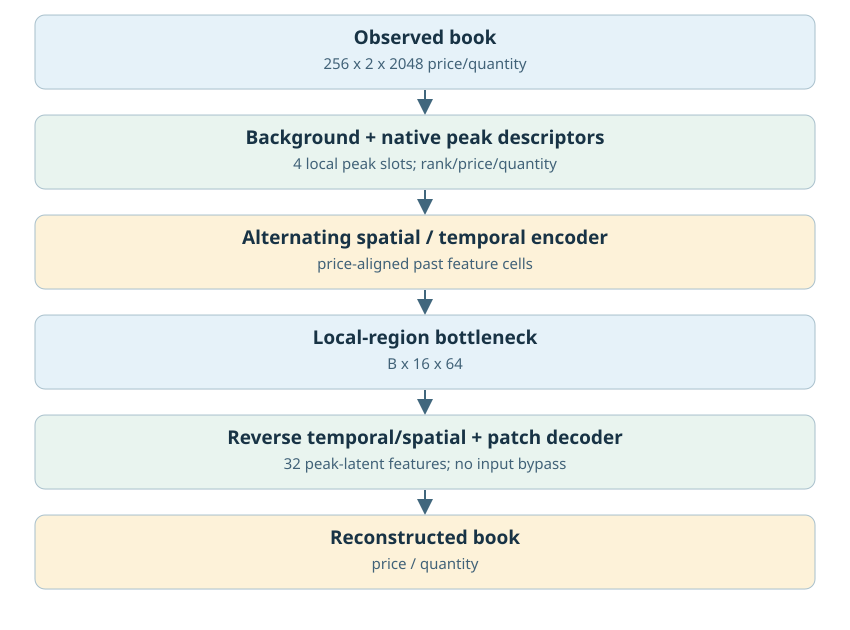
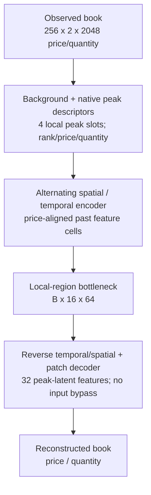
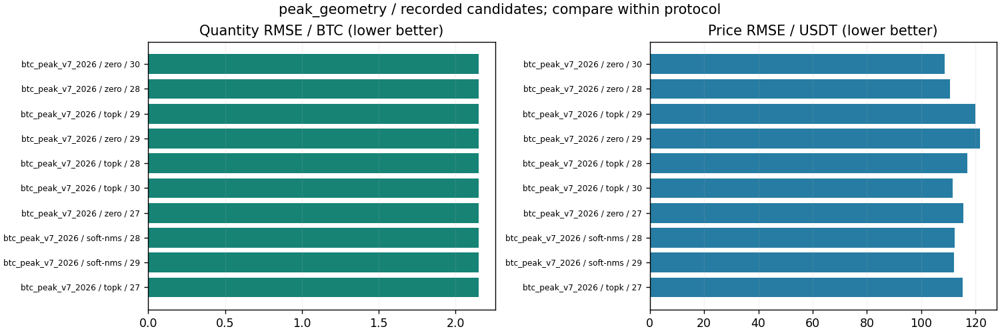

# 峰特征V7/价格几何V8

更新：2026-10-29T13:59:27.603099+08:00。输入范围：计划256分钟。

[返回总表](../README.md) · [模型谱系](../../MODEL_LINEAGE.md)

## 模型结构

以下图对应主要展示点的结构；分支其他可选结构见谱系说明，实际开关和精度以检查点配置为准。





- 瓶颈：[B,16,64]，1024标量。
- 架构变化：Top-K/Soft-NMS峰特征、价格几何与历史价格对齐。
- 结论边界：当前价格对齐上下文不是首次提出价格对齐；旧V8也不是当前单8192架构的匹配控制。
- 原模型代码（相对OBreconstuction）：`model/autoencoder/geometry.py`, `model/encoders/geometry.py`。

## 各评估口径的最佳已记录检查点

“最佳”定义为本分支、相同窗口长度/测试时段/窗口数/有效计数/目标RMS下所有已保存正步数评估中挂量RMSE最低；这是回顾性选点，包含中间检查点，不冒充独立测试确认；价格、≥100BTC指标和动态相关同时报告，不声称所有指标同时最优。不同口径分别保留最佳点，不做跨口径总冠军。下表第一项只是较大测试样本口径的展示代表。

| 组别 | 步数/epoch | 口径 | 价格RMSE USDT | 挂量RMSE BTC | ≥100召回 | ≥100精确率 | F1 | 动态相关 |
|---|---|---|---:|---:|---:|---:|---:|---:|
| model | 576 / 6 | 256分钟×2022窗，['2025-01-01', '2025-04-01'] | 181.61104 | 2.60009 | 未记录 | 未记录 | 未记录 | 未记录 |
| zero | 1920 / 30 | 256分钟×694窗，['2025-01-01', '2025-02-01'] | 108.53718 | 2.14836 | 未记录 | 未记录 | 未记录 | 未记录 |

### 最佳点1：model

- 实验：`checkpoints/btc_v8_corrected_2022_2024_val2025q1_20261021_142435`。
- 原始指标：`checkpoints/btc_v8_corrected_2022_2024_val2025q1_20261021_142435/model/metrics.jsonl`，字段/行：`line:6:validation`。
- [固定指标证据](best_0_evidence.json) · [权重元数据与哈希](best_0_checkpoint.json) · [原实验计划](best_0_plan.json)。
- 权重：`checkpoints/btc_v8_corrected_2022_2024_val2025q1_20261021_142435/model/best_quantity.pt`；SHA256 `dfeb9edbf52a1fe5122fb1b3b0947a6d003cca7bf075d9068fbcf8faca5c6159`。权重留在原项目，本次不向Git批量上传大检查点。

<details><summary>实际检查点结构配置</summary>

```json
{
  "epoch": 6,
  "model_config": {
    "architecture": "ae_peak_geometry_v8",
    "latent_dim": 64,
    "spatial_queries": 8,
    "features_per_query": 8,
    "spatial_regions": "2 sides x 4 contiguous depth bands",
    "decoder": "local region projection and spatial-query cross-attention",
    "bottleneck": "per-time local spatial attention; no temporal mixing or input token-channel flattening",
    "latent_shape_per_sample": [
      16,
      64
    ],
    "quantity_mode": "patch-residual",
    "quantity_decoder": "main full-latent decoder plus patch residual from 32 peak latent features; no raw input bypass",
    "conv_order": "alternating",
    "encoder_convolutions": "S0,T0,S1,T1,S2,T2,S3,T3,S4",
    "decoder_convolutions": "inverse S4,T3,S3,T2,S2,T1,S1,T0,S0",
    "temporal_stage_channels": [
      32,
      64,
      96,
      128
    ],
    "decoder_temporal_stage_channels": [
      128,
      96,
      64,
      32
    ],
    "peak_mode": "none",
    "book_structure": "price-aligned",
    "local_peak_slots": 4,
    "peak_placement": "encoder-only metadata merged after each spatial stride; all 2048 levels per side",
    "peak_selection": "native local maxima q>=left and q>right; strongest K per merged cell; no price NMS",
    "peak_descriptors": [
      "relative_price_to_cell_center",
      "original_scaled_quantity",
      "native_rank_offset",
      "present"
    ],
    "background_descriptors": [
      "mean_price",
      "mean_quantity",
      "unselected_quantity_per_valid_level",
      "valid_fraction"
    ],
    "temporal_alignment": "nearest past feature cell by price; zero outside observed range; no future or cross-side matches",
    "temporal_geometry": "stride anchors 2*j+1; final 16*j+15; raw descriptors at anchor only",
    "latent_layout": "8 local regions x (4 background + 4 peak features); 32+32 learned features per time",
    "limitations": "nearest cell alignment is not individual order tracking; selected input peaks are not guaranteed reconstructed peaks"
  },
  "state_tensor_count": 168,
  "state_scalars": 1351669
}
```

</details>

未找到与这个最佳点明确匹配的保存订单簿预测。本页展示真实指标/训练历史图，不借用其他检查点的曲线，不伪造订单簿预览。

### 最佳点2：zero

- 实验：`checkpoints/btc_peak_v7_20261018_235000`。
- 原始指标：`checkpoints/btc_peak_v7_20261018_235000/zero/metrics.jsonl`，字段/行：`line:30:validation`。
- [固定指标证据](best_1_evidence.json) · [权重元数据与哈希](best_1_checkpoint.json) · [原实验计划](best_1_plan.json)。
- 权重：`checkpoints/btc_peak_v7_20261018_235000/zero/best_quantity.pt`；SHA256 `1aedd187690878cab0e8a2362079c229126f417eb577da7400df005acf52b59e`。权重留在原项目，本次不向Git批量上传大检查点。

<details><summary>实际检查点结构配置</summary>

```json
{
  "epoch": 30,
  "model_config": {
    "architecture": "ae_peak_features_v7",
    "latent_dim": 64,
    "spatial_queries": 8,
    "features_per_query": 8,
    "spatial_regions": "2 sides x 4 contiguous depth bands",
    "decoder": "local region projection and spatial-query cross-attention",
    "bottleneck": "per-time local spatial attention; no temporal mixing or input token-channel flattening",
    "latent_shape_per_sample": [
      16,
      64
    ],
    "quantity_mode": "patch-residual",
    "quantity_decoder": "baseline plus zero-initialized short patch decoder from latent-expanded features; no input bypass",
    "conv_order": "alternating",
    "encoder_convolutions": "S0,T0,S1,T1,S2,T2,S3,T3,S4",
    "decoder_convolutions": "inverse S4,T3,S3,T2,S2,T1,S1,T0,S0",
    "temporal_stage_channels": [
      32,
      64,
      96,
      128
    ],
    "decoder_temporal_stage_channels": [
      128,
      96,
      64,
      32
    ],
    "peak_mode": "zero",
    "peak_features": [
      "selected",
      "original_scaled_quantity",
      "original_scaled_price",
      "clipped_half_height_width_over9"
    ],
    "peak_placement": "input native2048 levels, before first spatial downsampling",
    "peak_regions_per_side": 4,
    "peak_per_region": 8,
    "peak_candidates": 32,
    "peak_radius_bps": 0.5,
    "peak_sigma": 0.5,
    "peak_score_decay": "exp(-max(1-distance_bps/radius,0)^2/sigma)",
    "peak_input_projection": "zero initial extra input weights; original price/quantity channels preserved"
  },
  "state_tensor_count": 116,
  "state_scalars": 1166115
}
```

</details>

未找到与这个最佳点明确匹配的保存订单簿预测。本页展示真实指标/训练历史图，不借用其他检查点的曲线，不伪造订单簿预览。

## 所有保留候选与比较边界



图中最多展示10个低挂量误差点，只能在相同口径内比较；所有候选均保留在[candidates.json](candidates.json)。0步初始化不参与已训练分支排名；历史参考/未压缩模型不冒充压缩方案结果；训练拟合、合成移动峰和已见窗口不混入测试排名。历史2025Q1已重复查看，不称独立确认。

<!-- PARETO -->
## 价格与挂量的取舍

最小挂量误差可能以明显价格退化为代价；下面按每个评估口径分别列出价格/挂量二维非支配点（最多10个）。这是多目标取舍，不是因果或显著性结论。完整点仍在候选JSON中。

口径：`[256, ["2025-01-01", "2025-02-01"], 694, 727684864, null]`

| 组别 | step / epoch | 价格RMSE | 挂量RMSE |
|---|---|---:|---:|
| zero | 1920 / 30 | 108.5372 | 2.14836 |

口径：`[256, ["2025-01-01", "2025-04-01"], 2022, 2120220672, null]`

| 组别 | step / epoch | 价格RMSE | 挂量RMSE |
|---|---|---:|---:|
| model | 576 / 6 | 181.6110 | 2.60009 |
