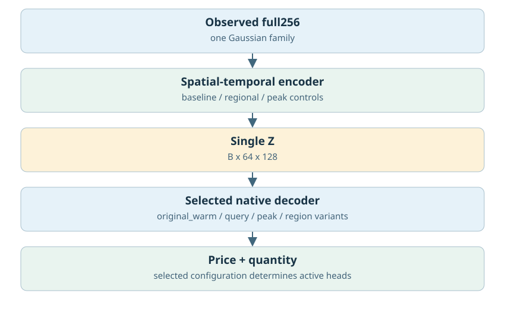
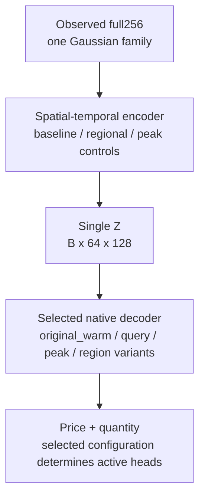
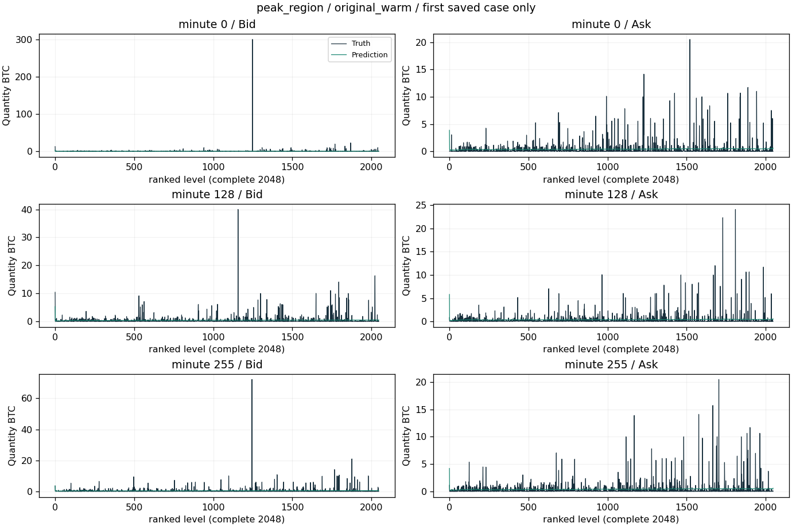
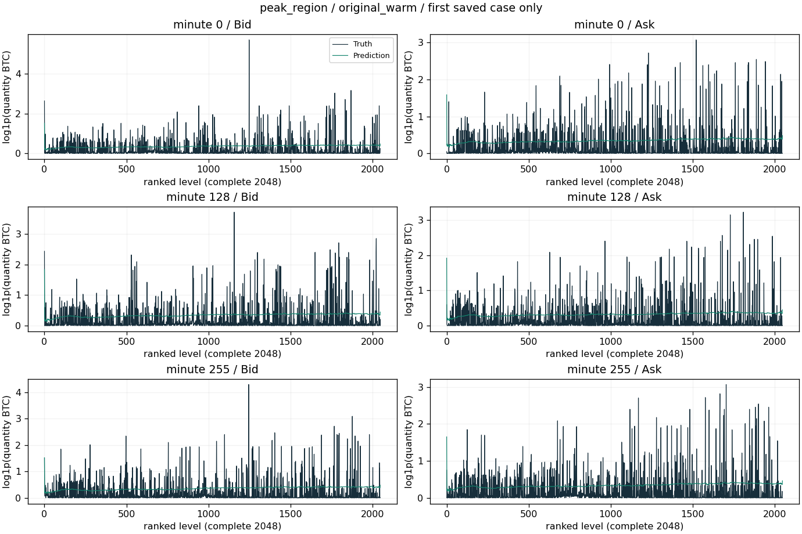
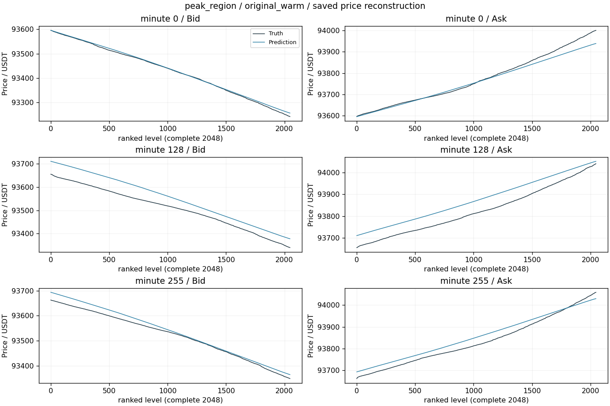
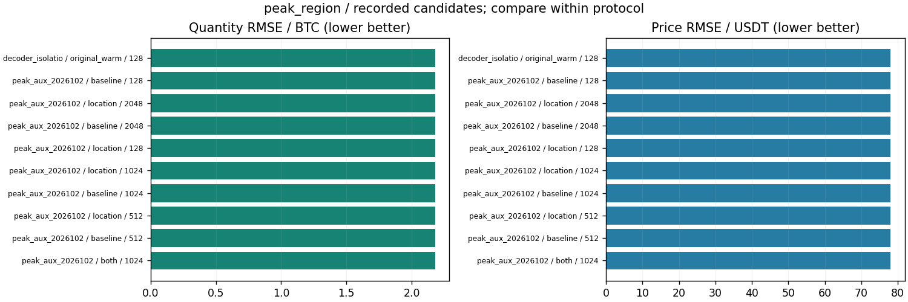

# 峰辅助、坐标查询与区域Gaussian组织

更新：2026-10-29T13:59:27.603099+08:00。输入范围：完整256分钟。

[返回总表](../README.md) · [模型谱系](../../MODEL_LINEAGE.md)

## 模型结构

以下图对应主要展示点的结构；分支其他可选结构见谱系说明，实际开关和精度以检查点配置为准。





- 瓶颈：同8192；区域组按64时间×2侧×8区域×8通道组织后固定展平。
- 架构变化：显式峰监督、QueryDecoder、RegionGrid与量价/仅数量任务控制。
- 结论边界：合成移动峰与4训练窗拟合不能作测试集泛化结果；区域组织仍只有一个Gaussian。
- 原模型代码（相对OBreconstuction）：`model/autoencoder/peak_book_vae.py`, `model/autoencoder/query_book_vae.py`, `model/autoencoder/region_grid_vae.py`。

## 各评估口径的最佳已记录检查点

“最佳”定义为本分支、相同窗口长度/测试时段/窗口数/有效计数/目标RMS下所有已保存正步数评估中挂量RMSE最低；这是回顾性选点，包含中间检查点，不冒充独立测试确认；价格、≥100BTC指标和动态相关同时报告，不声称所有指标同时最优。不同口径分别保留最佳点，不做跨口径总冠军。下表第一项只是较大测试样本口径的展示代表。

| 组别 | 步数/epoch | 口径 | 价格RMSE USDT | 挂量RMSE BTC | ≥100召回 | ≥100精确率 | F1 | 动态相关 |
|---|---|---|---:|---:|---:|---:|---:|---:|
| original_warm | 128 / None | 256分钟×16窗，['2025-01-01', '2025-04-01'] | 78.05317 | 2.17981 | 0.00% | 未记录 | 0.00% | 0.00008 |

### 最佳点1：original_warm

- 实验：`recons/decoder_isolation_20261027_105856`。
- 原始指标：`recons/decoder_isolation_20261027_105856/original_warm/step128_evaluation.json`，字段/行：`result`。
- [固定指标证据](best_0_evidence.json) · [权重元数据与哈希](best_0_checkpoint.json) · [原实验计划](best_0_plan.json)。
- **该点是控制/参考路径，不代表新增模块改善。**
- 权重：`recons/decoder_isolation_20261027_105856/original_warm/step128.pt`；SHA256 `3b8be3b6bd3d0750c57c9e5326041e454f3f6c6b7e71b5be15a910f858fa2658`。权重留在原项目，本次不向Git批量上传大检查点。

<details><summary>实际检查点结构配置</summary>

```json
{
  "unified_vae_config": {
    "levels": 2048,
    "quantity_scale": 7.517722085208762,
    "activation_checkpointing": true
  },
  "step": 128,
  "lane": "original_warm",
  "state_tensor_count": 240,
  "state_scalars": 11651542
}
```

</details>

原始预测：`recons/decoder_isolation_20261027_105856/original_warm/step128_profiles.npz`，SHA256 `4f6f96eaad9aa2020abc2be95d19d7d03abc2e1d6cdef455f1201f027299bae4`。固定第一个保存案例，分钟[0, 128, 255]，完整2048档。它是案例可视化，不替代全测试统计；没有新增模型推理。







[图中精确数据](best_0_display_points.npz)；未做深度平均、峰值截断或按误差挑样本。

### 若优先大单F1

保留候选中F1最高点：`recons/region_task_20261027_145807/region_joint`，step=2048，F1=0.36%，挂量RMSE=3.62145 BTC，价格RMSE=477.7653 USDT。它可能属于不同测试口径，不自动替代上面的最小挂量误差点。完整候选与口径见JSON。

## 同预算共同终点参考

该分支保留的共同终点评估中，最低挂量误差点为`recons/decoder_isolation_20261027_105856/original_warm`，step=128，挂量RMSE=2.17981 BTC、价格RMSE=78.0532 USDT。它与回顾性最低误差检查点是两个选型口径；不同来源或测试协议不能据此直接作因果比较。

## 所有保留候选与比较边界



图中最多展示10个低挂量误差点，只能在相同口径内比较；所有候选均保留在[candidates.json](candidates.json)。0步初始化不参与已训练分支排名；显式稀疏地址诊断单独标明。历史参考/未压缩模型不冒充压缩方案结果；训练拟合、合成移动峰和已见窗口不混入测试排名。历史2025Q1已重复查看，不称独立确认。

<!-- PARETO -->
## 价格与挂量的取舍

最小挂量误差可能以明显价格退化为代价；下面按每个评估口径分别列出价格/挂量二维非支配点（最多10个）。这是多目标取舍，不是因果或显著性结论。完整点仍在候选JSON中。

口径：`[256, ["2025-01-01", "2025-04-01"], 16, 16777216, 2.2170201]`

| 组别 | step / epoch | 价格RMSE | 挂量RMSE |
|---|---|---:|---:|
| original_warm | 128 / None | 78.0532 | 2.17981 |
