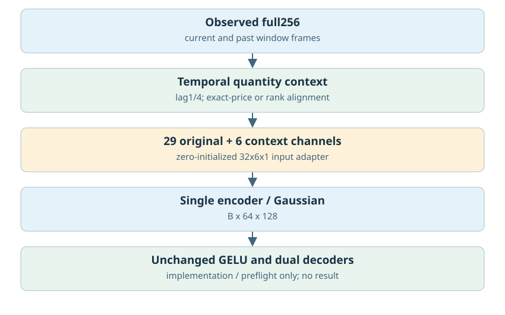
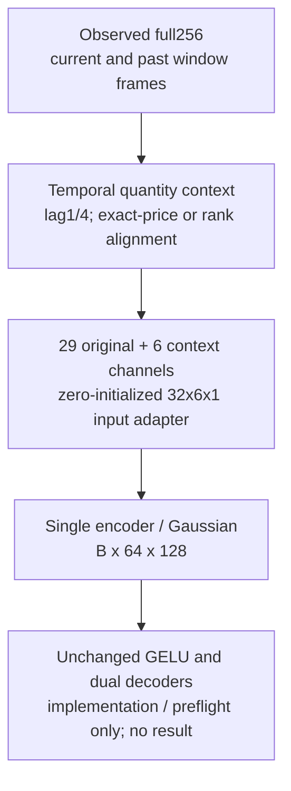
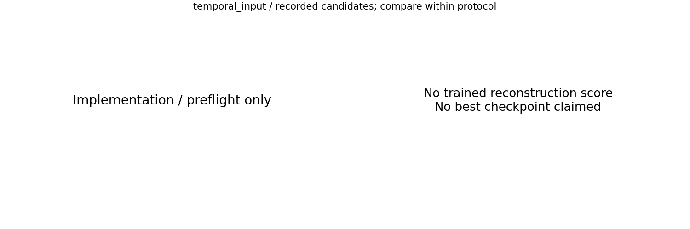

# 按档位/真实价格对齐的时间数量输入

更新：2026-10-29T13:59:27.603099+08:00。输入范围：完整256分钟。

[返回总表](../README.md) · [模型谱系](../../MODEL_LINEAGE.md)

## 模型结构

以下图对应主要展示点的结构；分支其他可选结构见谱系说明，实际开关和精度以检查点配置为准。

- 瓶颈：唯一[B,64,128]不变。
- 架构变化：lag1/4、rank/price对齐上下文，在Encoder内加6个输入通道。
- 结论边界：只读匹配审计或CPU预检不证明重建收益；整窗网络仍不能当作在线因果因子。
- 原模型代码（相对OBreconstuction）：`model/autoencoder/temporal_quantity_input_vae.py`。

## 最佳结果：尚不存在

已找到实现/预检或只读诊断，但没有可排名的已训练测试重建结果。不能把源模型的0步重放、单窗CPU预检或数据匹配审计当作本分支的新模型成绩。

现有证据：[audit_0.json](audit_0.json), [audit_1.json](audit_1.json), [audit_2.json](audit_2.json)。

## 所有保留候选与比较边界

图中最多展示10个低挂量误差点，只能在相同口径内比较；所有候选均保留在[candidates.json](candidates.json)。0步初始化不参与已训练分支排名；历史参考/未压缩模型不冒充压缩方案结果；训练拟合、合成移动峰和已见窗口不混入测试排名。历史2025Q1已重复查看，不称独立确认。

<!-- PARETO -->
## 价格与挂量的取舍

最小挂量误差可能以明显价格退化为代价；下面按每个评估口径分别列出价格/挂量二维非支配点（最多10个）。这是多目标取舍，不是因果或显著性结论。完整点仍在候选JSON中。
