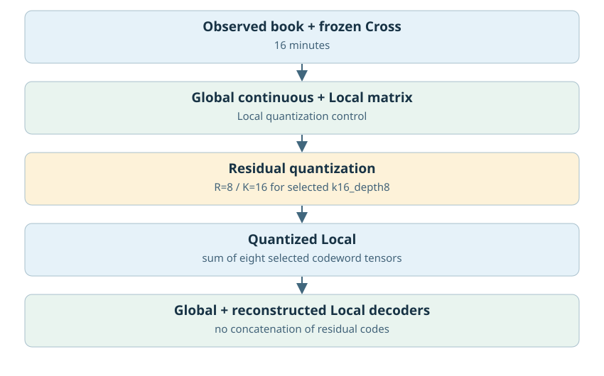
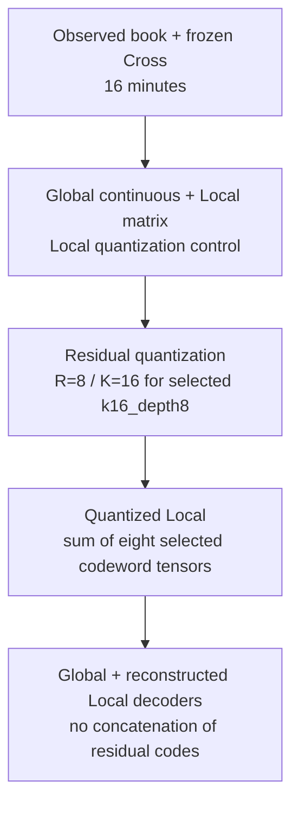
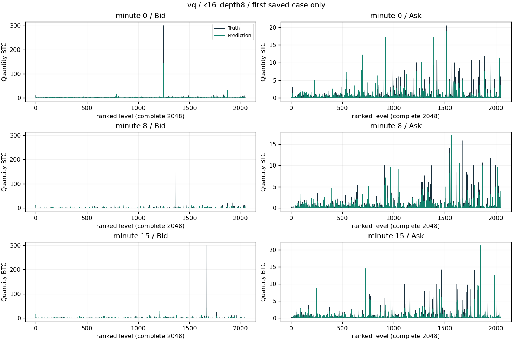
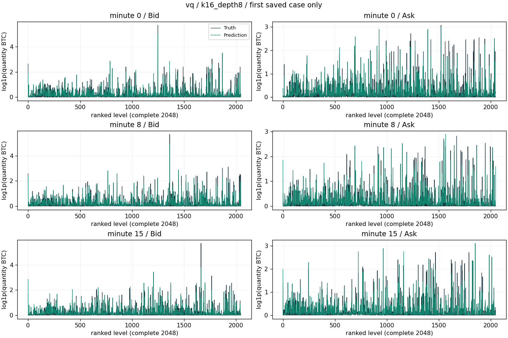
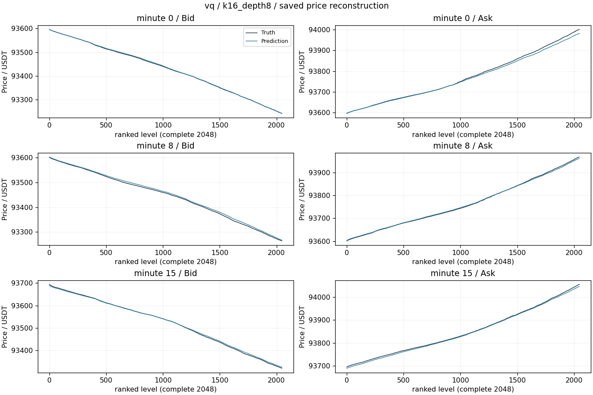
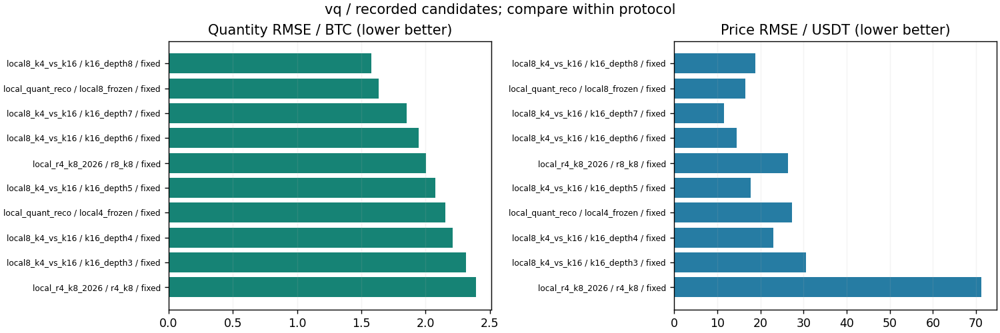

# VQ/RQ、小码本与配对矩阵

更新：2026-10-29T13:59:27.603099+08:00。输入范围：历史16分钟。

[返回总表](../README.md) · [模型谱系](../../MODEL_LINEAGE.md)

## 模型结构

以下图对应主要展示点的结构；分支其他可选结构见谱系说明，实际开关和精度以检查点配置为准。





- 瓶颈：量化对象包括连续状态和Global/Local矩阵，不同试验不共用同一形状。
- 架构变化：原RQ256码×8级；Global/Local共同索引；Local冻结量化；小K；R4×K8。
- 结论边界：残差量化重建是各级码字相加，不是拼接；级数不会自动成为经济学语义。索引、码字和量化后latent必须区分。
- 原模型代码（相对OBreconstuction）：`model/autoencoder/latent_rqvae.py`, `model/experimental/rq_window_state.py`, `model/experimental/paired_matrix_state.py`, `model/experimental/local_paired_state.py`, `model/experimental/tensor_cluster_state.py`。

## 各评估口径的最佳已记录检查点

“最佳”定义为本分支、相同窗口长度/测试时段/窗口数/有效计数/目标RMS下所有已保存正步数评估中挂量RMSE最低；这是回顾性选点，包含中间检查点，不冒充独立测试确认；价格、≥100BTC指标和动态相关同时报告，不声称所有指标同时最优。不同口径分别保留最佳点，不做跨口径总冠军。下表第一项只是较大测试样本口径的展示代表。

| 组别 | 步数/epoch | 口径 | 价格RMSE USDT | 挂量RMSE BTC | ≥100召回 | ≥100精确率 | F1 | 动态相关 |
|---|---|---|---:|---:|---:|---:|---:|---:|
| k16_depth8 | None / None | 16分钟×128窗，['2025-01-01', '2025-04-01'] | 18.83622 | 1.57866 | 36.08% | 89.57% | 51.44% | 0.74454 |
| k16_depth7 | None / None | 16分钟×16窗，['2025-01-01', '2025-04-01'] | 11.54727 | 1.85405 | 17.14% | 85.71% | 28.57% | 0.70995 |

### 最佳点1：k16_depth8

- 实验：`recons/local8_k4_vs_k16_20261026`。
- 原始指标：`recons/local8_k4_vs_k16_20261026/results.json`，字段/行：`k16_depth8`。
- [固定指标证据](best_0_evidence.json) · [权重元数据与哈希](best_0_checkpoint.json) · [原实验计划](best_0_plan.json)。
- 权重：`recons/local8_k4_vs_k16_20261026/k16/final.pt`；SHA256 `95207d655d3d139842e8eefabd8725c412adbc54aa8c2ee75f41cb793a77a955`。权重留在原项目，本次不向Git批量上传大检查点。

<details><summary>实际检查点结构配置</summary>

```json
{
  "model_config": {
    "levels": 2048,
    "quantity_scale": 1.0,
    "global_dim": 64,
    "local_dim": 16,
    "causal": false,
    "gap_activation": "softplus",
    "detach_price": false,
    "fix_first_mid": true
  },
  "local_paired_config": {
    "quant_window": 16,
    "quant_levels": 8,
    "quant_size": 16
  },
  "state_tensor_count": 320,
  "state_scalars": 4985261
}
```

</details>

原始预测：`recons/local8_k4_vs_k16_20261026/k16/profiles.npz`，SHA256 `e8a1e0ee8e33fe8a17005f3621440d7aaba07e6374a03626284f1e88ef0efaeb`。固定第一个保存案例，分钟[0, 8, 15]，完整2048档。它是案例可视化，不替代全测试统计；没有新增模型推理。







[图中精确数据](best_0_display_points.npz)；未做深度平均、峰值截断或按误差挑样本。

### 最佳点2：k16_depth7

- 实验：`recons/local8_k4_vs_k16_20261026`。
- 原始指标：`recons/local8_k4_vs_k16_20261026/results.json`，字段/行：`k16_depth7`。
- [固定指标证据](best_1_evidence.json) · [权重元数据与哈希](best_1_checkpoint.json) · [原实验计划](best_1_plan.json)。
- 没有找到可直接匹配的单一权重文件；不能视为已具备完整复现资产。

未找到与这个最佳点明确匹配的保存订单簿预测。本页展示真实指标/训练历史图，不借用其他检查点的曲线，不伪造订单簿预览。

### 若优先大单F1

保留候选中F1最高点：`recons/local8_k4_vs_k16_20261026/k16_depth8`，step=None，F1=51.44%，挂量RMSE=1.57866 BTC，价格RMSE=18.8362 USDT。它可能属于不同测试口径，不自动替代上面的最小挂量误差点。完整候选与口径见JSON。

## 所有保留候选与比较边界



图中最多展示10个低挂量误差点，只能在相同口径内比较；所有候选均保留在[candidates.json](candidates.json)。0步初始化不参与已训练分支排名；显式稀疏地址诊断单独标明。历史参考/未压缩模型不冒充压缩方案结果；训练拟合、合成移动峰和已见窗口不混入测试排名。历史2025Q1已重复查看，不称独立确认。

<!-- PARETO -->
## 价格与挂量的取舍

最小挂量误差可能以明显价格退化为代价；下面按每个评估口径分别列出价格/挂量二维非支配点（最多10个）。这是多目标取舍，不是因果或显著性结论。完整点仍在候选JSON中。

口径：`[16, ["2025-01-01", "2025-04-01"], 128, 8388608, 2.5344305]`

| 组别 | step / epoch | 价格RMSE | 挂量RMSE |
|---|---|---:|---:|
| k16_depth8 | None / None | 18.8362 | 1.57866 |
| local8_frozen | None / None | 16.4998 | 1.63716 |

口径：`[16, ["2025-01-01", "2025-04-01"], 16, 1048576, 2.5999663]`

| 组别 | step / epoch | 价格RMSE | 挂量RMSE |
|---|---|---:|---:|
| k16_depth7 | None / None | 11.5473 | 1.85405 |
